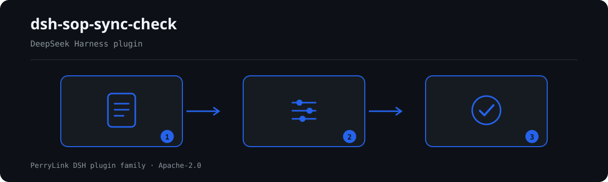

# dsh-sop-sync-check — Registo de instruções de trabalho e verificação de sincronia com o PFMEA / plano de controlo

[English](README.md) · [简体中文](README-zh.md) · [Español](README-es.md) · [Português](README-pt.md) · [हिन्दी](README-hi.md)

```sh
dsh plugin --profile <name> add dsh-sop-sync-check
```


[](https://dsh.market/)
[](https://dshfind.com/en/plugins/PerryLink/dsh-sop-sync-check?ref=badge)

`dsh-sop-sync-check` lê um registo de instruções de trabalho —o cabeçalho de produto mais uma linha por operação— e verifica a coerência mecânica desse registo com o PFMEA e o plano de controlo que cita: se cada linha de operação traz número de procedimento, se o PFMEA ou o plano de controlo é citado, se a revisão citada na linha coincide com a revisão que o registo indica como vigente, se um parâmetro declarado traz tolerância, se nenhum número de operação se repete, se o cabeçalho identifica o produto e se a data de revisão é analisável e não é posterior à data de verificação. Não julga se os parâmetros de processo estão corretos, se o plano de controlo cobre todos os modos de falha nem se a análise PFMEA é adequada; uma verificação que não pode correr é listada em `skipped` em vez de passar em silêncio.

## Install

```sh
dsh plugin --profile <name> add dsh-sop-sync-check
dsh --profile <name> --dump-config | grep 'dsh-sop-sync-check'
```

## Como é a saída



*Visão geral do fluxo: documento → regras → achados. Os exemplos abaixo usam a superfície real de comandos.*


Saída real deste plugin sobre o seu próprio fixture de teste `SS-005` — não é uma simulação. O pacote de regras não inventa citações, por isso cada achado nomeia a cláusula aplicada e avisa que o seu texto não foi obtido.

## O que ele responde

### Exemplos

A tabela abaixo é o conjunto de exemplos: a primeira linha é o caso detalhado e as demais são casos curtos.


#### Saída detalhada

**Ferramenta** `sop_sync_check`

**Entrada**

~~~json
{"pfmeaVersion":"V2","rows":[{"PFMEA编号":"PFMEA-2026-003 V1"}]}
~~~
 
**Saída**

~~~json
{
  "id": "dsh-sop-sync-check.SS-003.de09b5a6",
  "ruleId": "SS-003",
  "severity": "warn",
  "locator": {
    "row": 1,
    "field": "pfmeaRef"
  },
  "found": "第 1 行引用的版本「1」与文件现行版本「2」不一致",
  "expected": "引用的版本应与该文件的现行版本一致",
  "fix": "核对是否还停在上一版；本条只比对版本串，不判断该引用应当指向哪一版"
}
~~~

*Observado em `dsh-sop-sync-check/tests/fixtures/SS-003/SS-003-unsafe.json`*

| Você pergunta | O que ele responde |
|---|---|
| Uma linha de operação não tem número de procedimento na coluna 规程编号. | `SS-001` reporta essa linha: a regra exige que a coluna do número de procedimento esteja preenchida em toda a linha que a traga, e verifica apenas a presença, não se o procedimento é o certo para essa operação. Se o material não tiver essa coluna, a regra reporta que não se aplica em vez de passar em silêncio. |
| Ninguém anotou a que PFMEA ou a que plano de controlo pertence esta instrução de trabalho. | `SS-002` exige que se preencha em cada linha pelo menos um de PFMEA编号 e 控制计划编号. Verifica apenas que se cita pelo menos um, não que a referência seja adequada nem que a revisão indicada seja a vigente; essa comparação é a `SS-003`. |
| O procedimento continua a citar a revisão anterior do PFMEA. Isso é detetado? | Sim. `SS-003` lê a revisão de uma coluna própria ou de um marcador de versão no fim do texto da referência (`PFMEA-2026-003 V2`); o marcador precisa de uma pista explícita como `V`, `VER`, `REV`, `版本` ou `版次`, para que os dígitos finais de um número de documento nunca sejam tomados por uma revisão. Reporta a referência cujo texto de versão difere da revisão vigente do documento, e compara apenas cadeias de versão: não decide para que revisão a referência deveria apontar. Quando não há coluna de revisão nem cadeia legível, reporta-se a si mesma em `skipped`. |
| A coluna de parâmetros está preenchida, mas a de 参数公差 está vazia. | `SS-004` reporta essa linha, mas só quando a coluna de parâmetros está preenchida, pelo que uma operação que realmente não leva parâmetro não é assinalada. Verifica que a coluna de tolerância está preenchida, não que o parâmetro e a sua tolerância sejam razoáveis. |
| O mesmo número de operação aparece em duas linhas. | `SS-005` reporta o 工序号 repetido e nomeia a primeira linha em que apareceu; na comparação os espaços são ignorados. A repetição costuma significar registo duplicado ou número mal copiado: qual das linhas está certa continua a ser decisão humana. Sem coluna de número de operação, a regra reporta que não se aplica em vez de passar. |
| Uma data de revisão está como `2026/3/8` e outra linha traz a do mês que vem. | `SS-007` reporta uma 修订日期 que não consegue analisar e também uma data posterior à data de verificação. Verifica que a data é analisável e não cai depois da data de verificação; não julga se a revisão foi feita a tempo. |

## Normas que segue

Este pacote de regras não cita nenhuma norma pública: a verificação não obteve o texto literal das cláusulas da IATF 16949 nem dos manuais de ferramentas básicas do setor automóvel, pelo que o `basis` de cada regra o diz sem rodeios, todas são `derived-from-principle` e nenhuma passa de `warn`. Aquilo em que as verificações se apoiam são os números e revisões que o próprio registo declara —o número de procedimento da sua coluna, a revisão anotada ao lado da referência do PFMEA ou do plano de controlo, a tolerância ao lado de um parâmetro, a data de revisão— comparados entre si.

| Documento | Número | Regras que o citam |
|---|---|---|
| IATF 16949／汽车行业核心工具手册 | 现行版本与条号本次未核实 | SS-001, SS-002, SS-003, SS-004, SS-005, SS-006, SS-007 |

**Boundary:** this plugin checks a **作业规程台账** for mechanical consistency with its **PFMEA** and
**control plan** — that a number is recorded, that the PFMEA and control plan are cited, that the revision a
procedure cites matches the document's current revision, that a parameter has a tolerance, that process
numbers are unique, that the register names its product, and that revision dates parse. It does **not** judge
whether the process parameters are right, whether the control plan covers every failure mode, or whether the
PFMEA analysis is adequate. **Those are the process and quality engineers' judgements.**

> ### ⚠️ Read this before trusting a citation in the report
>
> **Every `excerpt` in this plugin's rule pack says, in so many words, that the clause text was not
> obtained.** The regime lives in IATF 16949 and the automotive core-tools handbooks (APQP, PFMEA, control
> plan). The verification pass could not retrieve verbatim clause text from them, so rather than paraphrase a
> quotation the pack states the gap in the `excerpt` field itself and puts the honest reasoning in `note`.
> Every rule is therefore `warn` or `info`, and a test asserts that no rule claims a quotation it does not
> have. **When the texts are in hand, two things must be done: replace each `excerpt` with the real clause,
> and raise `kind` to `direct`.**
>
> `SS-003` is the one that earns its keep: **a procedure still citing the previous PFMEA revision** is the
> commonest and most dangerous way the three documents drift apart. It reads the revision either from a
> dedicated column or from a version marker at the tail of the reference text (`PFMEA-2026-003 V2`), and it
> needs an explicit cue — `V`, `VER`, `REV`, `版本`, `版次` — so that the trailing digits of a *document
> number* are never mistaken for a revision. With neither source available it reports itself in `skipped`.

## Compatibility

| Superfície | Estado |
|---|---|
| Harness | Faixa de peers `>=0.1.2-rc.1 <0.2.0 \|\| >=0.2.0-0 <0.3.0` — verificada para aceitar tanto `0.2.0-rc.2` quanto `0.2.1-rc.2`. **`engines.dsh` é declarado como `>=0.2.1-0 <0.3.0`** e o host o aplica desde 0.2.1 |
| Node | `^22.19.0 || >=24.0.0` |
| Plataformas | Todas (ESM puro; sem código nativo, sem rede, sem chamada ao modelo) |
| Modo de ferramenta | Funciona em `native` e `ptc`; para um diretório inteiro use `ptc` |

## What it does

A tabela de regras, os campos e o comportamento detalhado estão em [README.md](README.md#what-it-does) (versão principal em inglês). O plugin apenas lista divergências literais frente às cláusulas citadas e indica em `skipped` cada verificação que não pôde ser executada.

## Configuration

Todos os parâmetros ajustáveis ficam no esquema Schemastery de `src/config.ts`, portanto mudam pelo `cordis.yml` sem editar código; os limites por regra ficam no pacote de regras sob `rules/`.

| Chave | Tipo | Padrão | Descrição |
|---|---|---|---|
| `rulesFile` | string | `rules/sop-sync-check.yaml` | Caminho do pacote de regras, relativo à raiz do pacote |
| `disabledRules` | string[] | `[]` | Ids de regras a desativar; cada uma aparece em `skipped` |
| `onlyRules` | string[] | `[]` | Executar apenas estas regras; vazio executa todas |
| `skipNotes` | string | `""` | Nota acrescentada a cada motivo de `skipped` |
| `timeoutMs` | number | `120000` | Orçamento de tempo limite cooperativo da ferramenta |

## Material format

Aceita JSON ou YAML. O exemplo completo de campos está em [README.md](README.md#material-format) (versão principal em inglês). Os campos são opcionais na camada de leitura e validados pelo motor, de modo que uma exportação parcial gera achados sobre o que falta em vez de falhar.

## Rule sources

Os dados das regras ficam separados do código: cada regra traz documento, número, cláusula na numeração própria da fonte, trecho literal e URL de origem. O carregador impõe que o trecho seja citação real de pelo menos oito caracteres e que uma verificação baseada apenas em princípio geral (`kind: derived-from-principle`, teto `warn`) ou em política local (`kind: institutional-configuration`, teto `info`) nunca seja declarada `error`.

Os limites verificados e as conclusões deliberadamente **não** afirmadas estão em [README.md](README.md#rule-sources) (versão principal em inglês) e em `rules/evidence/`.

## Troubleshooting

- **O plugin instala mas a ferramenta não aparece**: confirme que `main` resolve para `lib/index.mjs` e que `pnpm run build` o gerou.
- **`dsh plugin add` recusa o pacote**: a faixa de peers cobre `0.1.x` e `0.2.x`; fora dela, conceda isenção explícita com `dsh plugin --profile <name> allow-version <pkg@ver> --dsh-version <runtime> --accept-risk`.
- **Uma regra não executou**: leia o arranjo `skipped`.
- **`check` informa `manifest-peers` como falha**: problema conhecido do `dsh-plugin-dev`; o runtime aplica a compatibilidade na instalação.
- **Os horários parecem deslocados**: toda a aritmética é de hora local sobre as cadeias fornecidas.

## Development

```sh
pnpm install
pnpm run typecheck
pnpm test
pnpm run build
node ../scripts/sync-shared.mjs dsh-sop-sync-check
```

O último comando copia o kit compartilhado de `../_shared` para `src/shared/`; execute-o novamente após cada alteração compartilhada.

## PerryLink DSH Plugin Family

Este projeto faz parte da família de plugins do DeepSeek Harness da [PerryLink](https://github.com/PerryLink). O registro fica recolhido abaixo para que cada README mantenha uma primeira tela curta; expanda para ver cada linha e seu status.

<details>
<summary>Expandir todos os plugins</summary>

| Plugin | Status |
|---|---|
| **[dsh-aqua-input-check](https://github.com/PerryLink/dsh-aqua-input-check)** |  |
| **[dsh-archive-check](https://github.com/PerryLink/dsh-archive-check)** |  |
| **[dsh-auto-review](https://github.com/PerryLink/dsh-auto-review)** |  |
| **[dsh-autotier](https://github.com/PerryLink/dsh-autotier)** |  |
| **[dsh-bid-ca-precheck](https://github.com/PerryLink/dsh-bid-ca-precheck)** |  |
| **[dsh-bid-qual-check](https://github.com/PerryLink/dsh-bid-qual-check)** |  |
| **[dsh-cert-mcp](https://github.com/PerryLink/dsh-cert-mcp)** |  |
| **[dsh-checkpoint-rewind](https://github.com/PerryLink/dsh-checkpoint-rewind)** |  |
| **[dsh-click](https://github.com/PerryLink/dsh-click)** |  |
| **[dsh-composer-history](https://github.com/PerryLink/dsh-composer-history)** |  |
| **[dsh-contract-stance](https://github.com/PerryLink/dsh-contract-stance)** |  |
| **[dsh-customs-doc-check](https://github.com/PerryLink/dsh-customs-doc-check)** |  |
| **[dsh-data-quality](https://github.com/PerryLink/dsh-data-quality)** |  |
| **[dsh-demurrage-ledger](https://github.com/PerryLink/dsh-demurrage-ledger)** |  |
| **[dsh-doublecheck](https://github.com/PerryLink/dsh-doublecheck)** |  |
| **[dsh-drill-script-check](https://github.com/PerryLink/dsh-drill-script-check)** |  |
| **[dsh-eia-guide-check](https://github.com/PerryLink/dsh-eia-guide-check)** |  |
| **[dsh-emergency-plan](https://github.com/PerryLink/dsh-emergency-plan)** |  |
| **[dsh-essay-rubric-check](https://github.com/PerryLink/dsh-essay-rubric-check)** |  |
| **[dsh-evidence-check](https://github.com/PerryLink/dsh-evidence-check)** |  |
| **[dsh-export-ctl-check](https://github.com/PerryLink/dsh-export-ctl-check)** |  |
| **[dsh-fast](https://github.com/PerryLink/dsh-fast)** |  |
| **[dsh-fmea-table-check](https://github.com/PerryLink/dsh-fmea-table-check)** |  |
| **[dsh-forecast-penalty](https://github.com/PerryLink/dsh-forecast-penalty)** |  |
| **[dsh-fund-research](https://github.com/PerryLink/dsh-fund-research)** |  |
| **[dsh-github](https://github.com/PerryLink/dsh-github)** |  |
| **[dsh-gongwen-flow-check](https://github.com/PerryLink/dsh-gongwen-flow-check)** |  |
| **[dsh-gongwen-word-check](https://github.com/PerryLink/dsh-gongwen-word-check)** |  |
| **[dsh-guard-plan-qc](https://github.com/PerryLink/dsh-guard-plan-qc)** |  |
| **[dsh-hazchem-check](https://github.com/PerryLink/dsh-hazchem-check)** |  |
| **[dsh-hazplan-check](https://github.com/PerryLink/dsh-hazplan-check)** |  |
| **[dsh-hidden-risk-map](https://github.com/PerryLink/dsh-hidden-risk-map)** |  |
| **[dsh-hs-classify](https://github.com/PerryLink/dsh-hs-classify)** |  |
| **[dsh-icd-rule-check](https://github.com/PerryLink/dsh-icd-rule-check)** |  |
| **[dsh-industry-research](https://github.com/PerryLink/dsh-industry-research)** |  |
| **[dsh-lawcite-adapter](https://github.com/PerryLink/dsh-lawcite-adapter)** |  |
| **[dsh-laya](https://github.com/PerryLink/dsh-laya)** |  |
| **[dsh-lc-doc-check](https://github.com/PerryLink/dsh-lc-doc-check)** |  |
| **[dsh-learning-gap-check](https://github.com/PerryLink/dsh-learning-gap-check)** |  |
| **[dsh-library](https://github.com/PerryLink/dsh-library)** |  |
| **[dsh-local-ai](https://github.com/PerryLink/dsh-local-ai)** |  |
| **[dsh-lsp-actions](https://github.com/PerryLink/dsh-lsp-actions)** |  |
| **[dsh-mask](https://github.com/PerryLink/dsh-mask)** |  |
| **[dsh-mcp-panel](https://github.com/PerryLink/dsh-mcp-panel)** |  |
| **[dsh-medrec-qc](https://github.com/PerryLink/dsh-medrec-qc)** |  |
| **[dsh-memento](https://github.com/PerryLink/dsh-memento)** |  |
| **[dsh-nsfc-form-check](https://github.com/PerryLink/dsh-nsfc-form-check)** |  |
| **[dsh-nurse-record-check](https://github.com/PerryLink/dsh-nurse-record-check)** |  |
| **[dsh-observe](https://github.com/PerryLink/dsh-observe)** |  |
| **[dsh-origin-rvc-check](https://github.com/PerryLink/dsh-origin-rvc-check)** |  |
| **[dsh-ota-review-check](https://github.com/PerryLink/dsh-ota-review-check)** |  |
| **[dsh-output-styles](https://github.com/PerryLink/dsh-output-styles)** |  |
| **[dsh-paper-doc-adapter](https://github.com/PerryLink/dsh-paper-doc-adapter)** |  |
| **[dsh-permission-rules](https://github.com/PerryLink/dsh-permission-rules)** |  |
| **[dsh-permit-report-check](https://github.com/PerryLink/dsh-permit-report-check)** |  |
| **[dsh-pipeline-check](https://github.com/PerryLink/dsh-pipeline-check)** |  |
| **[dsh-pleading-draft](https://github.com/PerryLink/dsh-pleading-draft)** |  |
| **[dsh-plugin-doctor](https://github.com/PerryLink/dsh-plugin-doctor)** |  |
| **[dsh-plugin-guide](https://github.com/PerryLink/dsh-plugin-guide)** |  |
| **[dsh-plugin-kit](https://github.com/PerryLink/dsh-plugin-kit)** |  |
| **[dsh-plugin-upgrade](https://github.com/PerryLink/dsh-plugin-upgrade)** |  |
| **[dsh-policy-brief-draft](https://github.com/PerryLink/dsh-policy-brief-draft)** |  |
| **[dsh-power-loss-split](https://github.com/PerryLink/dsh-power-loss-split)** |  |
| **[dsh-power-ticket-check](https://github.com/PerryLink/dsh-power-ticket-check)** |  |
| **[dsh-ppap-check](https://github.com/PerryLink/dsh-ppap-check)** |  |
| **[dsh-protest-deadline](https://github.com/PerryLink/dsh-protest-deadline)** |  |
| **[dsh-railway-window](https://github.com/PerryLink/dsh-railway-window)** |  |
| **[dsh-repair-order-qc](https://github.com/PerryLink/dsh-repair-order-qc)** |  |
| **[dsh-research-report](https://github.com/PerryLink/dsh-research-report)** |  |
| **[dsh-review-reply-check](https://github.com/PerryLink/dsh-review-reply-check)** |  |
| **[dsh-rulefile-check](https://github.com/PerryLink/dsh-rulefile-check)** |  |
| **[dsh-safety-brief-check](https://github.com/PerryLink/dsh-safety-brief-check)** |  |
| **[dsh-score](https://github.com/PerryLink/dsh-score)** |  |
| **[dsh-session-sync](https://github.com/PerryLink/dsh-session-sync)** |  |
| **[dsh-site-log-check](https://github.com/PerryLink/dsh-site-log-check)** |  |
| **[dsh-skill-pack-security](https://github.com/PerryLink/dsh-skill-pack-security)** |  |
| **[dsh-soe-decision-check](https://github.com/PerryLink/dsh-soe-decision-check)** |  |
| **[dsh-soilwater-check](https://github.com/PerryLink/dsh-soilwater-check)** |  |
| **[dsh-sop-sync-check](https://github.com/PerryLink/dsh-sop-sync-check)** |  |
| **[dsh-spc-gbt-adapter](https://github.com/PerryLink/dsh-spc-gbt-adapter)** |  |
| **[dsh-talk](https://github.com/PerryLink/dsh-talk)** |  |
| **[dsh-tender-extract](https://github.com/PerryLink/dsh-tender-extract)** |  |
| **[dsh-tender-matrix](https://github.com/PerryLink/dsh-tender-matrix)** |  |
| **[dsh-test-drive](https://github.com/PerryLink/dsh-test-drive)** |  |
| **[dsh-ticktick](https://github.com/PerryLink/dsh-ticktick)** |  |
| **[dsh-translate](https://github.com/PerryLink/dsh-translate)** |  |
| **[dsh-warranty-calc](https://github.com/PerryLink/dsh-warranty-calc)** |  |
| **[dsh-budget](https://github.com/PerryLink/dsh-budget)** | 🧊 CONGELADO — ver o README do repositório |
| **[dsh-claude-move](https://github.com/PerryLink/dsh-claude-move)** | 🧊 CONGELADO — ver o README do repositório |
| **[dsh-defend](https://github.com/PerryLink/dsh-defend)** | 🧊 CONGELADO — ver o README do repositório |
| **[dsh-draw](https://github.com/PerryLink/dsh-draw)** | 🧊 CONGELADO — ver o README do repositório |
| **[dsh-reach](https://github.com/PerryLink/dsh-reach)** | 🧊 CONGELADO — ver o README do repositório |
| **[dsh-background-agents](https://github.com/PerryLink/dsh-background-agents)** | 🚫 RETIRADO — ver o README do repositório |
| **[dsh-session-pin](https://github.com/PerryLink/dsh-session-pin)** | 🚫 RETIRADO — ver o README do repositório |
| **[dsh-team-rooms](https://github.com/PerryLink/dsh-team-rooms)** | 🚫 RETIRADO — ver o README do repositório |

</details>

## License

[Apache License 2.0](LICENSE) © 2026 dsh-sop-sync-check contributors.
