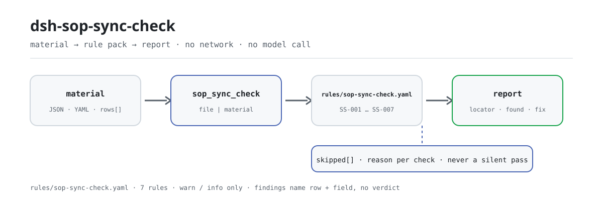

<div align="center">

<picture>
  <source media="(prefers-color-scheme: dark)" srcset="docs/assets/dsh-sop-sync-check-flow-dark.svg">
  
</picture>

# dsh-sop-sync-check

**Line up a works-instruction register with the PFMEA and control plan it cites — and get told which row, which column, and what differs.**

A reconciliation checker for process, quality, and document-control work: hand it one works-instruction register, and it compares it mechanically against a versioned rule pack, returning a list of differences you can point at row by row. It never edits the original, and it never rules on compliance.

[Install](#three-step-setup) · [Configuration](#configuration) · [FAQ](#faq) · [简体中文](README.md) · [English](README.en.md) · [Español](README.es.md) · [Português](README.pt.md) · [हिन्दी](README.hi.md)

[](LICENSE)
[](#compatibility)
[](https://www.npmjs.com/package/dsh-sop-sync-check)
[](https://github.com/PerryLink/dsh-sop-sync-check/actions/workflows/ci.yml)
[](#compatibility)

[](https://github.com/PerryLink/dsh-sop-sync-check/stargazers)
[](https://www.npmjs.com/package/dsh-sop-sync-check)
[](https://dshfind.com/plugins/PerryLink/dsh-sop-sync-check?ref=badge)
[](https://securityscorecards.dev/viewer/?uri=github.com/PerryLink/dsh-sop-sync-check)
[](https://dsh.market/)
[](https://gitee.com/perrylink/dsh-sop-sync-check)

```sh
dsh plugin --profile <name> add dsh-sop-sync-check
```

</div>

<sub>Community plugin, not affiliated with DeepSeek. Canonical repository: <https://github.com/PerryLink/dsh-sop-sync-check> (Gitee is a mirror).</sub>

## What it is

`dsh-sop-sync-check` reads one works-instruction register — the product header plus one row per process — and checks that register's mechanical consistency with the PFMEA and control plan it cites: that each process row carries a procedure number, that the PFMEA or control plan is cited at all, that the revision a row cites matches the revision the register records as the document's current one, that a stated parameter carries a tolerance, that no process number is repeated, that the header names its product, and that the revision date parses and is not later than the check date. It does not judge whether the process parameters are right, whether the control plan covers every failure mode, or whether the PFMEA analysis is adequate; a check that cannot run is listed in `skipped` instead of passing silently.

It is built for process, quality, and document-control staff who should not have to touch a command line: give it the source material the check works on — a table, register, or document — and the original is never modified. Excel can be converted to JSON/YAML first, in chat if the platform supports it.

```text
material (JSON / YAML) ──▶ sop_sync_check ──▶ rules/sop-sync-check.yaml ──▶ report
                                                                    └─▶ skipped (unrunnable check + reason)
```

## Three-step setup

1. **Install** (pick one channel):

   ```sh
   # git channel (latest main)
   dsh plugin --profile <name> add github:PerryLink/dsh-sop-sync-check
   # npm channel (published release, currently 0.2.9)
   dsh plugin --profile <name> add dsh-sop-sync-check
   # tarball channel: pnpm pack in this repo, then
   dsh plugin --profile <name> add ./dsh-sop-sync-check-<version>.tgz
   ```

   It is also part of "Professional Document Check Suite" on WorkBuddy / Coze (the full set; this check is one part of it; availability as listed in each marketplace).

2. **Minimal material** (JSON or YAML; a header plus one row per process):

   ```yaml
   productNo: P-2026-001
   productName: Front bracket
   rows:
     - { sopNo: WI-2026-018, processNo: OP20, processName: finish-turn OD,
         parameter: spindle speed 1200 r/min, tolerance: ±50 r/min,
         pfmeaRef: PFMEA-2026-003 V2, pfmeaVersion: V2,
         controlPlanRef: CP-2026-003 V2, controlPlanVersion: V2, revisedAt: 2026-03-08 }
   ```

3. **Verify it is live**:

   ```sh
   dsh --profile <name> --dump-config | grep 'dsh-sop-sync-check'
   ```

   Then ask the model to call `sop_sync_check`, passing the material above as `file` or `material`. You can also run the in-repo sample without a host:

   ```sh
   pnpm install
   pnpm run build
   node samples/quickstart/run.mjs --json
   ```

   The output matches `samples/quickstart/expected/result.json` (`issueCount: 2`, `warn: 2`, `skippedCount: 1`); drop `--json` for a one-line summary. Terminal screenshot: [`docs/assets/quickstart.png`](docs/assets/quickstart.png).

**Uninstall**: `dsh plugin --profile <name> remove dsh-sop-sync-check` (or remove the row from the profile patch).

## Core capabilities

The rule pack is data: `rules/sop-sync-check.yaml` declares every check, so replacing that file switches rule-set versions without touching TypeScript. The pack is validated on load, not trusted; every finding reports a row and column, what was found, what was expected, and a fix hint.

| Rule | Check | Severity | Basis kind |
|---|---|---|---|
| `SS-001` | every process declares a procedure number | warn | principle |
| `SS-002` | the procedure cites its PFMEA or control plan | warn | principle |
| `SS-003` | the cited revision matches the document's current revision | warn | principle |
| `SS-004` | a stated parameter carries a tolerance | warn | principle |
| `SS-005` | process numbers are unique | warn | principle |
| `SS-006` | the register names its product | warn | principle |
| `SS-007` | the revision date parses and is not in the future | warn | principle |

- **Locatable to the row and column.** The report's `locator` carries `row` and `field`; `found` / `expected` / `fix` say what was seen, what was wanted, and how to correct it — the decision stays human.
- **An empty result is not a clean bill.** Every check that could not run lands in `skipped` with its reason, and a disabled rule appears there too instead of vanishing silently.
- **Literal comparison only.** It does not judge whether parameters are reasonable, whether the control plan covers every failure mode, or whether the PFMEA analysis is adequate — and it issues no compliance, liability, or correctness verdict.
- **Version strings need an explicit cue.** `SS-003` treats only what follows `V`, `VER`, `REV`, or a version/revision word as a revision, so the trailing digits of a document number are never mistaken for one.

### Tool surface

| Argument | Required | Meaning |
|---|---|---|
| `file` | one of the two | path to the material file (JSON or YAML) |
| `material` | one of the two | inline material text (JSON or YAML) |
| `rulesFile` | no | override the configured rule-pack path (package-relative or absolute) |
| `only` | no | run only these rule ids; empty runs every rule (combined with the configured `onlyRules`) |

### Examples

The output below is this plugin's real output on its own `SS-003` fixture, not an illustration. The rule pack does not fabricate citations, so every finding also names the clause it applied and states that the clause text was not obtained this round.

**Tool** `sop_sync_check`

**Input**

```json
{"pfmeaVersion":"V2","rows":[{"PFMEA编号":"PFMEA-2026-003 V1"}]}
```

**Output**

```json
{
  "id": "dsh-sop-sync-check.SS-003.de09b5a6",
  "ruleId": "SS-003",
  "severity": "warn",
  "locator": {
    "row": 1,
    "field": "pfmeaRef"
  },
  "found": "第 1 行引用的版本「1」与文件现行版本「2」不一致",
  "expected": "引用的版本应与该文件的现行版本一致",
  "fix": "核对是否还停在上一版；本条只比对版本串，不判断该引用应当指向哪一版"
}
```

*Observed from `dsh-sop-sync-check/tests/fixtures/SS-003/SS-003-unsafe.json`*

Rule by rule:

| You ask | What it answers |
|---|---|
| A process row leaves the procedure-number column empty. | `SS-001` reports that row: the rule requires the procedure-number column to be filled on every row that carries it, and it checks presence only — not whether the procedure is the right one for that process. If the material has no such column at all, the rule reports that it does not apply instead of passing silently. |
| Nobody wrote down which PFMEA or control plan this works instruction belongs to. | `SS-002` requires at least one of the PFMEA-reference and control-plan-reference columns to be filled on each row. It checks only that at least one is cited — not whether the reference is apt, and not whether the revision it names is the current one; that comparison is `SS-003`. |
| The procedure still cites the previous PFMEA revision. Will that be caught? | Yes. `SS-003` reads the revision from a dedicated revision column or from a version marker at the tail of the reference text (`PFMEA-2026-003 V2`); the marker needs an explicit cue such as `V`, `VER`, `REV`, or a version/revision word, so the trailing digits of a document number are never mistaken for a revision. It reports the reference whose version string differs from the document's current revision, and it compares version strings only — it does not decide which revision the reference should point to. When neither a revision column nor a readable version string is available it reports itself in `skipped`. |
| The parameter column is filled but the tolerance column is empty. | `SS-004` reports that row — but only when the parameter column is filled, so a process that genuinely carries no parameter is not flagged. It checks that the tolerance column is filled, not that the parameter and its tolerance are reasonable. |
| The same process number appears on two rows. | `SS-005` reports the repeated process number and names the first row it saw with that number; whitespace is ignored in the comparison. Repetition usually means a double registration or a mistyped process number — which row is right stays a human decision. With no process-number column at all the rule reports that it does not apply rather than passing. |
| A revision date reads `2026/3/8`, and one row is dated next month. | `SS-007` reports a revision date it cannot parse, and a date later than the check date. It checks that the date parses and does not fall after the check date; it does not judge whether the revision was made promptly. |

## Configuration

Every tunable lives in the Schemastery schema in `src/config.ts`, so it can be changed from `cordis.yml` without editing code; per-rule thresholds live in the rule-pack files under `rules/`.

| Key | Type | Default | Description |
|---|---|---|---|
| `rulesFile` | string | `rules/sop-sync-check.yaml` | Rule-pack path, relative to the package root |
| `disabledRules` | string[] | `[]` | Rule ids to stop running; each appears in `skipped` |
| `onlyRules` | string[] | `[]` | Run only these rule ids; empty runs every rule |
| `skipNotes` | string | `""` | Note appended to every `skipped` reason |
| `timeoutMs` | number | `120000` | Cooperative tool timeout budget |

<details>
<summary>Rule-level parameters (SS-003 / SS-004)</summary>

- `SS-003` uses `referenceField` / `actualVersionField` / `sameVersionField` to decide where the cited revision and the document's current revision live. `actualVersionField` may be a list; the first non-empty candidate wins, and a bare version (`V2`) or a reference carrying one (`PFMEA-2026-003 V2`) both work. If your register keeps the cited revision in its own column, name it in `sameVersionField`.
- `SS-004` uses `conditionField` / `requiredFields` to decide which column triggers the requirement and what it needs.

These fields live in the rule-pack file and are separate from the five runtime keys in `config.ts`: one changes the rules, the other changes deployment behaviour.

</details>

Example override in your profile patch:

```yaml
- insert:
    - id: dsh-sop-sync-check
      name: dsh-sop-sync-check
      config:
        onlyRules: [SS-001, SS-003, SS-005]
        skipNotes: institutional implementation rules v3
        timeoutMs: 60000
```

## FAQ

<details>
<summary>Where does the material go? Is anything stored?</summary>

Nowhere: no network, no model call, no file writes. The plugin reads only the file you pass as `file` or the inline text you pass as `material`, parses and compares it in-process, and returns the report to the current session. The repository contains no network code and no credential configuration.

</details>

<details>
<summary>If a rule did not run, could that be read as "no problem"?</summary>

No. Every check that could not run — a missing column, no comparable version string, a disabled rule — is listed in `skipped` with its rule id and reason, and `config.skipNotes` can append an institutional note to each entry. An empty issue list means only that every check that could run found no difference; it does not mean the material is clean.

</details>

<details>
<summary>Does it decide compliance or liability for me?</summary>

No. It lists literal differences that can be pointed at inside the material, for human review, and the report carries a disclaimer; it issues no compliance, liability, or correctness verdict. Whether process parameters are reasonable, whether the control plan covers every failure mode, and whether the PFMEA analysis is adequate are the process and quality engineers' judgements.

</details>

<details>
<summary>Will it fight other plugins over tool names or events?</summary>

It registers exactly one tool, `sop_sync_check` (`inject: ['tools']`), and registers no command, no client slot, no HTTP route, and no service key. Registration is a Cordis effect, so unloading or hot-reloading removes it.

</details>

<details>
<summary>How big is the performance overhead?</summary>

Pure string and table work, with no network and no model call. The default cooperative timeout budget is `timeoutMs: 120000`, enforced by the tool-execution framework. One register is checked in a single call; for checking many materials in a batch, prefer the `ptc` tool mode so the schema cost is paid once.

</details>

## Standards & citation boundaries

This rule pack cites no public standard: the verification obtained no verbatim clause text from IATF 16949 or the automotive core-tools handbooks, so every rule's `basis` says so in as many words, each is `derived-from-principle`, and none rises above `warn`. What the checks rest on instead is the register's own stated numbers and revisions — the procedure number it writes in its own column, the revision it records against the PFMEA or control plan reference, the tolerance beside a parameter, the revision date — compared with one another.

| Document | Number | Cited by rules |
|---|---|---|
| IATF 16949 / automotive core-tools handbooks | current revision and clause numbers not verified this round | SS-001, SS-002, SS-003, SS-004, SS-005, SS-006, SS-007 |

**Boundary:** this plugin checks a **works-instruction register** for mechanical consistency with its **PFMEA** and **control plan** — that a number is recorded, that the PFMEA and control plan are cited, that the revision a procedure cites matches the document's current revision, that a parameter has a tolerance, that process numbers are unique, that the register names its product, and that revision dates parse. It does **not** judge whether the process parameters are right, whether the control plan covers every failure mode, or whether the PFMEA analysis is adequate. **Those are the process and quality engineers' judgements.**

> ### ⚠️ Read this before trusting a citation in the report
>
> **Every `excerpt` in this plugin's rule pack says, in so many words, that the clause text was not obtained.** The regime lives in IATF 16949 and the automotive core-tools handbooks (APQP, PFMEA, control plan). The verification pass could not retrieve verbatim clause text from them, so rather than paraphrase a quotation the pack states the gap in the `excerpt` field itself and puts the honest reasoning in `note`. Every rule is therefore `warn` or `info`, and a test asserts that no rule claims a quotation it does not have. **When the texts are in hand, two things must be done: replace each `excerpt` with the real clause, and raise `kind` to `direct`.**
>
> `SS-003` is the one that earns its keep: **a procedure still citing the previous PFMEA revision** is the commonest and most dangerous way the three documents drift apart. It reads the revision either from a dedicated column or from a version marker at the tail of the reference text (`PFMEA-2026-003 V2`), and it needs an explicit cue — `V`, `VER`, `REV`, or a version/revision word — so that the trailing digits of a *document number* are never mistaken for a revision. With neither source available it reports itself in `skipped`.

## Material format

The tool accepts JSON or YAML. Fields are optional at the reading layer and validated by the check engine, so a partial export produces "missing item" findings instead of a crash.

```yaml
productNo: P-2026-001
productName: 前支架
rows:
  - { 规程编号: WI-2026-018, 工序号: OP20, 工序名称: 精车外圆,
      工艺参数: 主轴转速 1200 r/min, 参数公差: ±50 r/min,
      PFMEA编号: PFMEA-2026-003 V2, PFMEA现行版本: V2,
      控制计划编号: CP-2026-003 V2, 控制计划现行版本: V2, 修订日期: 2026-03-08 }
```

Column names are matched case-insensitively and ignoring spaces, underscores and hyphens; the register's own column names are kept, so a finding names the column you actually wrote. The header may use `productNo`, `productName`, and the PFMEA / control-plan current revisions; the sample above spells out the Chinese column headers the reader accepts. Dates may be `2026-03-08` or `2026-03-08 09:30`.

## Rule sources

Rule data lives in `rules/sop-sync-check.yaml`. The pack's header states the citation gap in full, and each rule's `note` repeats the part that matters for that rule. Each rule carries a document, a number, a clause number in the source's own numbering, a verbatim excerpt, and a source URL. The load-time guard enforces that an excerpt is a real quotation of at least eight characters, and that a check whose basis is only a general principle (`kind: derived-from-principle`, capped at `warn`) or a local policy (`kind: institutional-configuration`, capped at `info`) is never labelled `error`. That guard cannot tell a quotation from a description, so this pack leans on its header, the per-rule notes, and a test asserting that every `excerpt` admits the gap; a pack that overstates its basis fails at load rather than producing a confident-looking report.

The boundaries confirmed during verification, and the conclusions deliberately **not** drawn, are recorded in the bundled `rules/evidence/` directory.

## Compatibility

| Surface | Status |
|---|---|
| Harness | Peer range `>=0.1.2-rc.1 <0.2.0 \|\| >=0.2.0-0 <0.3.0` — verified to accept both `0.2.0-rc.2` and `0.2.1-rc.2`. `engines.dsh` is declared as `>=0.2.1-0 <0.3.0` and is enforced by the host since 0.2.1 |
| Node | `^22.19.0 \|\| >=24.0.0` |
| Platforms | All (plain ESM; no native code, no network, no model call) |
| Tool mode | Works in `native` and `ptc`; for a full works-instruction set use `ptc` |

## Troubleshooting

- **The plugin installs but the tool never appears.** Check that `main` resolves to `lib/index.mjs` and that `pnpm run build` produced it; a wrong `main` makes the loader skip the entry silently.
- **`dsh plugin add` refuses the package as incompatible.** The peer range covers `0.1.x` and `0.2.x`; if your runtime sits outside it, grant an explicit exemption: `dsh plugin --profile <name> allow-version dsh-sop-sync-check@0.2.9 --dsh-version <runtime> --accept-risk`.
- **A rule did not run.** Read the `skipped` array: it names the rule id and the reason.
- **`SS-003` reports itself as skipped.** Neither the cited revision nor the document's current revision could be read. Give the register a dedicated current-revision column (the reader accepts the aliases documented above), or put the revision in the reference text as `V2`.
- **`SS-003` does not fire although I know the revisions differ.** Check the column resolution order: `actualVersionField` takes the first non-empty candidate, so a stale column listed earlier will mask a later one.
- **`SS-003` fires on a reference with no revision.** That is the check — a reference that does not say which revision it is on cannot be compared.
- **`SS-004` fires on a process with no tolerance.** Either the parameter genuinely has one and it is missing, or the process carries no parameter and the parameter column should be empty.
- **`check` reports `manifest-peers` as failed.** The static checker compares against a hard-coded peer range that predates the 0.2 line; the runtime enforces peer compatibility at install time, so the declared range is the correct one. This is a known upstream issue in `dsh-plugin-dev`.
- **Timestamps look shifted.** All arithmetic is wall-clock over the strings you supply; no time-zone conversion is performed.

## Ecosystem & quality

- [Gitee mirror](https://gitee.com/perrylink/dsh-sop-sync-check) (sync mirror; GitHub is canonical)
- [dshfind plugin page](https://dshfind.com/plugins/PerryLink/dsh-sop-sync-check) (installs and ranking)
- [OpenSSF Scorecard report](https://securityscorecards.dev/viewer/?uri=github.com/PerryLink/dsh-sop-sync-check) (driven by [.github/workflows/scorecard.yml](.github/workflows/scorecard.yml))
- [DSH Market](https://dsh.market/) (listed)
- [Choose a checker by material](https://perrylink.github.io/zh/checkers/choose/) (family index: 62 checkers plus the general-purpose plugins)

## Development

```sh
pnpm install
pnpm run typecheck   # tsc --noEmit
pnpm test            # vitest, the shared table-plugin suite plus paired fixtures
pnpm run build       # tsdown -> lib/index.mjs + lib/index.d.mts
node ../scripts/sync-shared.mjs dsh-sop-sync-check   # refresh src/shared
pnpm run check:readmes                               # five-language README consistency
```

Item 5 copies the shared kit from `../_shared` into `src/shared/`; re-run it after every shared change.

The plugin is **data-driven**: `src/model.ts` declares the table shape and column aliases, `src/shared/` supplies the reader and the check engine, and the rule pack declares every check. The README images are generated programmatically by [`scripts/gen-readme-assets.py`](scripts/gen-readme-assets.py) (Python + Pillow) and are safe to re-run.

Topics: `dsh`, `dsh-plugin`, `deepseek-harness`, `deepseek`, `cordis`, `sop`, `sync`

## Family & thanks

This project is part of the DeepSeek Harness plugin family from [PerryLink](https://github.com/PerryLink) (all Apache-2.0). If it is useful, **a star helps the next person find it** — nothing is gated behind it.

- [@PerryLink](https://github.com/PerryLink) — creator and maintainer: the rule-pack design, the table reader and check engine, the `sop_sync_check` tool, and the five-language docs.

<details>
<summary>Expand all plugins</summary>

| Plugin | Status |
|---|---|
| **[dsh-aqua-input-check](https://github.com/PerryLink/dsh-aqua-input-check)** |  |
| **[dsh-archive-check](https://github.com/PerryLink/dsh-archive-check)** |  |
| **[dsh-auto-review](https://github.com/PerryLink/dsh-auto-review)** |  |
| **[dsh-autotier](https://github.com/PerryLink/dsh-autotier)** | 🧊 FROZEN — see the repo README |
| **[dsh-bid-ca-precheck](https://github.com/PerryLink/dsh-bid-ca-precheck)** |  |
| **[dsh-bid-qual-check](https://github.com/PerryLink/dsh-bid-qual-check)** |  |
| **[dsh-cert-mcp](https://github.com/PerryLink/dsh-cert-mcp)** | 🧊 FROZEN — see the repo README |
| **[dsh-checkpoint-rewind](https://github.com/PerryLink/dsh-checkpoint-rewind)** |  |
| **[dsh-click](https://github.com/PerryLink/dsh-click)** |  |
| **[dsh-composer-history](https://github.com/PerryLink/dsh-composer-history)** |  |
| **[dsh-contract-stance](https://github.com/PerryLink/dsh-contract-stance)** |  |
| **[dsh-customs-doc-check](https://github.com/PerryLink/dsh-customs-doc-check)** |  |
| **[dsh-data-quality](https://github.com/PerryLink/dsh-data-quality)** |  |
| **[dsh-demurrage-ledger](https://github.com/PerryLink/dsh-demurrage-ledger)** |  |
| **[dsh-doublecheck](https://github.com/PerryLink/dsh-doublecheck)** |  |
| **[dsh-drill-script-check](https://github.com/PerryLink/dsh-drill-script-check)** |  |
| **[dsh-eia-guide-check](https://github.com/PerryLink/dsh-eia-guide-check)** |  |
| **[dsh-emergency-plan](https://github.com/PerryLink/dsh-emergency-plan)** |  |
| **[dsh-essay-rubric-check](https://github.com/PerryLink/dsh-essay-rubric-check)** |  |
| **[dsh-evidence-check](https://github.com/PerryLink/dsh-evidence-check)** |  |
| **[dsh-export-ctl-check](https://github.com/PerryLink/dsh-export-ctl-check)** |  |
| **[dsh-fast](https://github.com/PerryLink/dsh-fast)** |  |
| **[dsh-fmea-table-check](https://github.com/PerryLink/dsh-fmea-table-check)** |  |
| **[dsh-forecast-penalty](https://github.com/PerryLink/dsh-forecast-penalty)** |  |
| **[dsh-fund-research](https://github.com/PerryLink/dsh-fund-research)** |  |
| **[dsh-github](https://github.com/PerryLink/dsh-github)** |  |
| **[dsh-gongwen-flow-check](https://github.com/PerryLink/dsh-gongwen-flow-check)** |  |
| **[dsh-gongwen-word-check](https://github.com/PerryLink/dsh-gongwen-word-check)** |  |
| **[dsh-guard-plan-qc](https://github.com/PerryLink/dsh-guard-plan-qc)** |  |
| **[dsh-hazchem-check](https://github.com/PerryLink/dsh-hazchem-check)** |  |
| **[dsh-hazplan-check](https://github.com/PerryLink/dsh-hazplan-check)** |  |
| **[dsh-hidden-risk-map](https://github.com/PerryLink/dsh-hidden-risk-map)** |  |
| **[dsh-hs-classify](https://github.com/PerryLink/dsh-hs-classify)** |  |
| **[dsh-icd-rule-check](https://github.com/PerryLink/dsh-icd-rule-check)** |  |
| **[dsh-industry-research](https://github.com/PerryLink/dsh-industry-research)** |  |
| **[dsh-lawcite-adapter](https://github.com/PerryLink/dsh-lawcite-adapter)** |  |
| **[dsh-laya](https://github.com/PerryLink/dsh-laya)** |  |
| **[dsh-lc-doc-check](https://github.com/PerryLink/dsh-lc-doc-check)** |  |
| **[dsh-learning-gap-check](https://github.com/PerryLink/dsh-learning-gap-check)** |  |
| **[dsh-library](https://github.com/PerryLink/dsh-library)** |  |
| **[dsh-local-ai](https://github.com/PerryLink/dsh-local-ai)** |  |
| **[dsh-lsp-actions](https://github.com/PerryLink/dsh-lsp-actions)** |  |
| **[dsh-mask](https://github.com/PerryLink/dsh-mask)** |  |
| **[dsh-mcp-panel](https://github.com/PerryLink/dsh-mcp-panel)** |  |
| **[dsh-medrec-qc](https://github.com/PerryLink/dsh-medrec-qc)** |  |
| **[dsh-memento](https://github.com/PerryLink/dsh-memento)** |  |
| **[dsh-nsfc-form-check](https://github.com/PerryLink/dsh-nsfc-form-check)** |  |
| **[dsh-nurse-record-check](https://github.com/PerryLink/dsh-nurse-record-check)** |  |
| **[dsh-observe](https://github.com/PerryLink/dsh-observe)** |  |
| **[dsh-origin-rvc-check](https://github.com/PerryLink/dsh-origin-rvc-check)** |  |
| **[dsh-ota-review-check](https://github.com/PerryLink/dsh-ota-review-check)** |  |
| **[dsh-output-styles](https://github.com/PerryLink/dsh-output-styles)** |  |
| **[dsh-paper-doc-adapter](https://github.com/PerryLink/dsh-paper-doc-adapter)** |  |
| **[dsh-permission-rules](https://github.com/PerryLink/dsh-permission-rules)** |  |
| **[dsh-permit-report-check](https://github.com/PerryLink/dsh-permit-report-check)** |  |
| **[dsh-pipeline-check](https://github.com/PerryLink/dsh-pipeline-check)** |  |
| **[dsh-pleading-draft](https://github.com/PerryLink/dsh-pleading-draft)** |  |
| **[dsh-plugin-doctor](https://github.com/PerryLink/dsh-plugin-doctor)** | 🚫 RETIRED (repo archived) |
| **[dsh-plugin-guide](https://github.com/PerryLink/dsh-plugin-guide)** |  |
| **[dsh-plugin-kit](https://github.com/PerryLink/dsh-plugin-kit)** | 🚫 RETIRED (repo archived) |
| **[dsh-plugin-upgrade](https://github.com/PerryLink/dsh-plugin-upgrade)** | 🚫 RETIRED (repo archived) |
| **[dsh-policy-brief-draft](https://github.com/PerryLink/dsh-policy-brief-draft)** |  |
| **[dsh-power-loss-split](https://github.com/PerryLink/dsh-power-loss-split)** |  |
| **[dsh-power-ticket-check](https://github.com/PerryLink/dsh-power-ticket-check)** |  |
| **[dsh-ppap-check](https://github.com/PerryLink/dsh-ppap-check)** |  |
| **[dsh-protest-deadline](https://github.com/PerryLink/dsh-protest-deadline)** |  |
| **[dsh-railway-window](https://github.com/PerryLink/dsh-railway-window)** |  |
| **[dsh-repair-order-qc](https://github.com/PerryLink/dsh-repair-order-qc)** |  |
| **[dsh-research-report](https://github.com/PerryLink/dsh-research-report)** |  |
| **[dsh-review-reply-check](https://github.com/PerryLink/dsh-review-reply-check)** |  |
| **[dsh-rulefile-check](https://github.com/PerryLink/dsh-rulefile-check)** |  |
| **[dsh-safety-brief-check](https://github.com/PerryLink/dsh-safety-brief-check)** |  |
| **[dsh-score](https://github.com/PerryLink/dsh-score)** |  |
| **[dsh-session-sync](https://github.com/PerryLink/dsh-session-sync)** |  |
| **[dsh-site-log-check](https://github.com/PerryLink/dsh-site-log-check)** |  |
| **[dsh-skill-pack-security](https://github.com/PerryLink/dsh-skill-pack-security)** |  |
| **[dsh-soe-decision-check](https://github.com/PerryLink/dsh-soe-decision-check)** |  |
| **[dsh-soilwater-check](https://github.com/PerryLink/dsh-soilwater-check)** |  |
| **[dsh-sop-sync-check](https://github.com/PerryLink/dsh-sop-sync-check)** |  |
| **[dsh-spc-gbt-adapter](https://github.com/PerryLink/dsh-spc-gbt-adapter)** |  |
| **[dsh-talk](https://github.com/PerryLink/dsh-talk)** |  |
| **[dsh-tender-extract](https://github.com/PerryLink/dsh-tender-extract)** |  |
| **[dsh-tender-matrix](https://github.com/PerryLink/dsh-tender-matrix)** |  |
| **[dsh-test-drive](https://github.com/PerryLink/dsh-test-drive)** |  |
| **[dsh-ticktick](https://github.com/PerryLink/dsh-ticktick)** | 🚫 RETIRED (repo archived) |
| **[dsh-translate](https://github.com/PerryLink/dsh-translate)** |  |
| **[dsh-warranty-calc](https://github.com/PerryLink/dsh-warranty-calc)** |  |
| **[dsh-budget](https://github.com/PerryLink/dsh-budget)** | 🧊 FROZEN — see the repo README |
| **[dsh-claude-move](https://github.com/PerryLink/dsh-claude-move)** | 🧊 FROZEN — see the repo README |
| **[dsh-defend](https://github.com/PerryLink/dsh-defend)** | 🧊 FROZEN — see the repo README |
| **[dsh-draw](https://github.com/PerryLink/dsh-draw)** | 🧊 FROZEN — see the repo README |
| **[dsh-reach](https://github.com/PerryLink/dsh-reach)** | 🧊 FROZEN — see the repo README |
| **[dsh-background-agents](https://github.com/PerryLink/dsh-background-agents)** | 🚫 RETIRED (repo archived) |
| **[dsh-session-pin](https://github.com/PerryLink/dsh-session-pin)** | 🚫 RETIRED (repo archived) |
| **[dsh-team-rooms](https://github.com/PerryLink/dsh-team-rooms)** | 🚫 RETIRED (repo archived) |
</details>

## License

[LICENSE](LICENSE) (Apache License 2.0) © 2026 dsh-sop-sync-check contributors

<p align="center"><sub>Apache-2.0 · Community plugin, not affiliated with DeepSeek.</sub></p>
