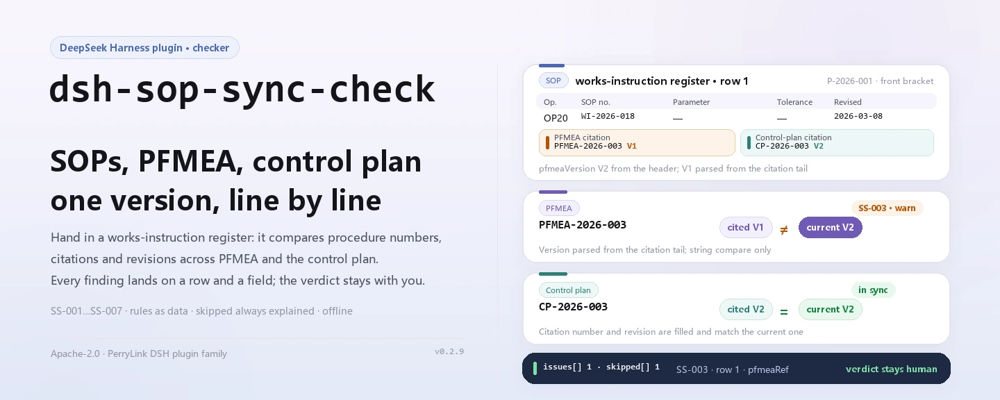
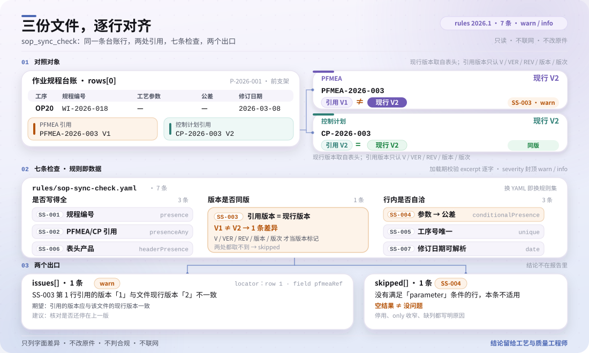

<div align="center">

<picture>
  <source media="(prefers-color-scheme: dark)" srcset="docs/assets/dsh-sop-sync-check-hero-en-dark.webp">
  
</picture>

# dsh-sop-sync-check

**Alinea el registro de instrucciones de trabajo con el PFMEA y el plan de control que cita, y te dice qué fila, qué columna y qué difiere.**

Una herramienta de conciliación para proceso, calidad y control documental: entrégale un registro de instrucciones de trabajo y lo compara mecánicamente con un paquete de reglas versionado, devolviendo una lista de diferencias señalables fila por fila. No modifica el original ni dictamina cumplimiento.

[Instalación](#instalación-en-tres-pasos) · [Configuración](#configuración) · [FAQ](#faq) · [简体中文](README.md) · [English](README.en.md) · [Español](README.es.md) · [Português](README.pt.md) · [हिन्दी](README.hi.md)

[](LICENSE)
[](#compatibilidad)
[](https://www.npmjs.com/package/dsh-sop-sync-check)
[](https://github.com/PerryLink/dsh-sop-sync-check/actions/workflows/ci.yml)
[](#compatibilidad)

[](https://github.com/PerryLink/dsh-sop-sync-check/stargazers)
[](https://www.npmjs.com/package/dsh-sop-sync-check)
[](https://dshfind.com/plugins/PerryLink/dsh-sop-sync-check?ref=badge)
[](https://securityscorecards.dev/viewer/?uri=github.com/PerryLink/dsh-sop-sync-check)
[](https://dsh.market/)
[](https://gitee.com/perrylink/dsh-sop-sync-check)

```sh
dsh plugin --profile <name> add dsh-sop-sync-check
```

</div>

<sub>Plugin de la comunidad, sin relación con DeepSeek. Repositorio canónico: <https://github.com/PerryLink/dsh-sop-sync-check> (Gitee es un espejo).</sub>

## Qué es

`dsh-sop-sync-check` lee un registro de instrucciones de trabajo —la cabecera de producto más una fila por operación— y comprueba la coherencia mecánica de ese registro con el PFMEA y el plan de control que cita: que cada fila de operación lleve número de procedimiento, que se cite el PFMEA o el plan de control, que la revisión citada en la fila coincida con la revisión que el registro da como vigente, que un parámetro declarado lleve tolerancia, que no se repita ningún número de operación, que la cabecera identifique el producto y que la fecha de revisión se pueda analizar y no sea posterior a la fecha de comprobación. No juzga si los parámetros de proceso son correctos, si el plan de control cubre todos los modos de fallo ni si el análisis PFMEA es adecuado; una comprobación que no puede ejecutarse se lista en `skipped` en lugar de pasar en silencio.

Está pensado para personal de proceso, calidad y control documental que no debería tocar una línea de comandos: se entrega el material de origen de la comprobación —una tabla, un registro o un documento— y el original nunca se modifica. Excel puede convertirse antes a JSON/YAML, en el chat si la plataforma lo admite.

```text
material (JSON / YAML) ──▶ sop_sync_check ──▶ rules/sop-sync-check.yaml ──▶ informe
                                                                    └─▶ skipped (comprobación no ejecutable + motivo)
```

<picture>
  <source media="(prefers-color-scheme: dark)" srcset="docs/assets/dsh-sop-sync-check-flow-v5-dark.svg">
  
</picture>

## Instalación en tres pasos

1. **Instalar** (elige un canal):

   ```sh
   # canal git (último main)
   dsh plugin --profile <name> add github:PerryLink/dsh-sop-sync-check
   # canal npm (versión publicada; actualmente 0.2.9)
   dsh plugin --profile <name> add dsh-sop-sync-check
   # canal tarball: tras pnpm pack en este repositorio
   dsh plugin --profile <name> add ./dsh-sop-sync-check-<version>.tgz
   ```

   También forma parte de «Professional Document Check Suite» en WorkBuddy / Coze (el conjunto completo; esta comprobación es una parte; disponibilidad según cada mercado).

2. **Material mínimo** (JSON o YAML; una cabecera y una fila por operación):

   ```yaml
   productNo: P-2026-001
   productName: 前支架
   rows:
     - { 规程编号: WI-2026-018, 工序号: OP20, 工序名称: 精车外圆,
         工艺参数: 主轴转速 1200 r/min, 参数公差: ±50 r/min,
         PFMEA编号: PFMEA-2026-003 V2, PFMEA现行版本: V2,
         控制计划编号: CP-2026-003 V2, 控制计划现行版本: V2, 修订日期: 2026-03-08 }
   ```

3. **Verificar que está activo**:

   ```sh
   dsh --profile <name> --dump-config | grep 'dsh-sop-sync-check'
   ```

   Después pide al modelo que llame a `sop_sync_check` pasando el material anterior como `file` o `material`. También puedes ejecutar el ejemplo del repositorio sin host:

   ```sh
   pnpm install
   pnpm run build
   node samples/quickstart/run.mjs --json
   ```

   La salida coincide con `samples/quickstart/expected/result.json` (`issueCount: 2`, `warn: 2`, `skippedCount: 1`); quita `--json` para un resumen de una línea. Captura de terminal: [`docs/assets/quickstart.png`](docs/assets/quickstart.png).

**Desinstalar**: `dsh plugin --profile <name> remove dsh-sop-sync-check` (o elimina la fila del patch del perfil).

## Capacidades principales

El paquete de reglas es dato: `rules/sop-sync-check.yaml` declara cada comprobación, así que sustituir ese archivo cambia la versión del conjunto de reglas sin tocar TypeScript. El paquete se valida al cargar, no se confía en él; cada hallazgo informa de fila y columna, de lo encontrado, lo esperado y una sugerencia de corrección.

| Regla | Comprobación | Severidad | Tipo de base |
|---|---|---|---|
| `SS-001` | cada operación declara número de procedimiento | warn | principio |
| `SS-002` | el procedimiento cita su PFMEA o plan de control | warn | principio |
| `SS-003` | la revisión citada coincide con la revisión vigente del documento | warn | principio |
| `SS-004` | un parámetro declarado lleva tolerancia | warn | principio |
| `SS-005` | los números de operación son únicos | warn | principio |
| `SS-006` | el registro nombra su producto | warn | principio |
| `SS-007` | la fecha de revisión se analiza y no está en el futuro | warn | principio |

- **Localizable por fila y columna.** El `locator` del informe lleva `row` y `field`; `found` / `expected` / `fix` dicen qué se vio, qué se esperaba y cómo corregirlo: la decisión sigue siendo humana.
- **Un resultado vacío no es un certificado.** Toda comprobación que no pudo ejecutarse entra en `skipped` con su motivo, y una regla desactivada también aparece ahí en lugar de desaparecer en silencio.
- **Solo comparación literal.** No juzga si los parámetros son razonables, si el plan de control cubre todos los modos de fallo o si el análisis PFMEA es suficiente, y no emite veredictos de cumplimiento, responsabilidad o corrección.
- **Las cadenas de versión necesitan una señal explícita.** `SS-003` solo trata como revisión lo que sigue a `V`, `VER`, `REV` o una palabra de versión/revisión, de modo que los dígitos finales de un número de documento nunca se confundan con una revisión.

### Superficie de la herramienta

| Argumento | Obligatorio | Significado |
|---|---|---|
| `file` | uno de los dos | ruta del archivo de material (JSON o YAML) |
| `material` | uno de los dos | texto de material en línea (JSON o YAML) |
| `rulesFile` | no | sustituye la ruta del paquete de reglas configurada (relativa al paquete o absoluta) |
| `only` | no | ejecuta solo esas reglas; vacío ejecuta todas (combinado con `onlyRules` de la configuración) |

### Ejemplos

La salida siguiente es la salida real de este plugin sobre su propio fixture `SS-003`, no una ilustración. El paquete de reglas no inventa citas, así que cada hallazgo nombra la cláusula aplicada y advierte que su texto no se obtuvo esta vez.

**Herramienta** `sop_sync_check`

**Entrada**

```json
{"pfmeaVersion":"V2","rows":[{"PFMEA编号":"PFMEA-2026-003 V1"}]}
```

**Salida**

```json
{
  "id": "dsh-sop-sync-check.SS-003.de09b5a6",
  "ruleId": "SS-003",
  "severity": "warn",
  "locator": {
    "row": 1,
    "field": "pfmeaRef"
  },
  "found": "第 1 行引用的版本「1」与文件现行版本「2」不一致",
  "expected": "引用的版本应与该文件的现行版本一致",
  "fix": "核对是否还停在上一版；本条只比对版本串，不判断该引用应当指向哪一版"
}
```

*Observed from `dsh-sop-sync-check/tests/fixtures/SS-003/SS-003-unsafe.json`*

Regla por regla:

| Usted pregunta | Qué responde |
|---|---|
| Una fila de operación deja vacía la columna del número de procedimiento. | `SS-001` informa de esa fila: la regla exige que la columna del número de procedimiento esté rellena en toda fila que la traiga, y solo comprueba la presencia, no que el procedimiento sea el que corresponde a esa operación. Si el material no tiene esa columna, la regla informa de que no aplica en lugar de pasar en silencio. |
| Nadie anotó a qué PFMEA o a qué plan de control pertenece esta instrucción de trabajo. | `SS-002` exige que se rellene en cada fila al menos una de las columnas de referencia al PFMEA y al plan de control. Solo comprueba que se cite al menos una, no que la referencia sea acertada ni que su revisión sea la vigente; esa comparación es `SS-003`. |
| El procedimiento sigue citando la revisión anterior del PFMEA. ¿Se detecta? | Sí. `SS-003` toma la revisión de una columna propia o de un marcador de versión al final del texto de la referencia (`PFMEA-2026-003 V2`); el marcador necesita una señal explícita como `V`, `VER`, `REV` o una palabra de versión/revisión, de modo que los dígitos finales de un número de documento nunca se tomen por una revisión. Informa de la referencia cuyo texto de versión difiere de la revisión vigente del documento, y solo compara cadenas de versión: no decide a qué revisión debería apuntar la referencia. Cuando no hay ni columna de revisión ni cadena legible, se informa a sí misma en `skipped`. |
| La columna de parámetros está rellena, pero la de tolerancia está vacía. | `SS-004` informa de esa fila, pero solo cuando la columna de parámetros está rellena, así que una operación que realmente no lleva parámetro no se señala. Comprueba que la columna de tolerancia esté rellena, no que el parámetro y su tolerancia sean razonables. |
| El mismo número de operación aparece en dos filas. | `SS-005` informa del número de operación repetido y nombra la primera fila en que apareció; en la comparación se ignoran los espacios. La repetición suele significar un registro duplicado o un número mal copiado: qué fila es la correcta sigue siendo decisión humana. Sin columna de número de operación, la regla informa de que no aplica en lugar de pasar. |
| Una fecha de revisión figura como `2026/3/8` y otra fila lleva la del mes que viene. | `SS-007` informa de una fecha de revisión que no puede analizar y de una fecha posterior a la fecha de comprobación. Comprueba que la fecha se analice y no caiga después de la fecha de comprobación; no juzga si la revisión se hizo a tiempo. |

## Configuración

Todos los parámetros ajustables viven en el esquema Schemastery de `src/config.ts`, por lo que se cambian desde `cordis.yml` sin tocar el código; los umbrales por regla están en el paquete de reglas bajo `rules/`.

| Clave | Tipo | Predeterminado | Descripción |
|---|---|---|---|
| `rulesFile` | string | `rules/sop-sync-check.yaml` | Ruta del paquete de reglas, relativa a la raíz del paquete |
| `disabledRules` | string[] | `[]` | Ids de reglas que se dejan de ejecutar; cada una aparece en `skipped` |
| `onlyRules` | string[] | `[]` | Ejecutar solo estas reglas; vacío ejecuta todas |
| `skipNotes` | string | `""` | Nota añadida a cada motivo de `skipped` |
| `timeoutMs` | number | `120000` | Presupuesto de tiempo de espera cooperativo de la herramienta |

<details>
<summary>Parámetros por regla (SS-003 / SS-004)</summary>

- `SS-003` usa `referenceField` / `actualVersionField` / `sameVersionField` para decidir de qué columna salen la revisión citada y la revisión vigente del documento. `actualVersionField` puede ser una lista; gana el primer candidato no vacío, y funcionan tanto una versión suelta (`V2`) como una referencia que la lleve (`PFMEA-2026-003 V2`). Si el registro guarda la revisión citada en su propia columna, indíquela en `sameVersionField`.
- `SS-004` usa `conditionField` / `requiredFields` para decidir qué columna activa el requisito y qué necesita.

Estos campos viven en el archivo del paquete de reglas y son independientes de las cinco claves de ejecución de `config.ts`: unos cambian las reglas y las otras el comportamiento del despliegue.

</details>

Ejemplo de sustitución en el patch del perfil:

```yaml
- insert:
    - id: dsh-sop-sync-check
      name: dsh-sop-sync-check
      config:
        onlyRules: [SS-001, SS-003, SS-005]
        skipNotes: reglas internas de implantación v3
        timeoutMs: 60000
```

## FAQ

<details>
<summary>¿A dónde va el material? ¿Se guarda algo?</summary>

A ningún sitio: sin red, sin llamadas al modelo y sin escritura de archivos. El plugin solo lee el archivo que pasas como `file` o el texto en línea que pasas como `material`, lo analiza y compara en el proceso, y devuelve el informe a la sesión actual. El repositorio no contiene código de red ni configuración de credenciales.

</details>

<details>
<summary>Si una regla no se ejecutó, ¿puede leerse como «no hay problema»?</summary>

No. Toda comprobación que no pudo ejecutarse —una columna ausente, ninguna cadena de versión comparable, una regla desactivada— se lista en `skipped` con su id y su motivo, y `config.skipNotes` puede añadir una nota institucional a cada entrada. Una lista de problemas vacía solo significa que las comprobaciones ejecutables no hallaron diferencias; no significa que el material esté limpio.

</details>

<details>
<summary>¿Decide cumplimiento o responsabilidad por mí?</summary>

No. Solo enumera diferencias literales señalables dentro del material, para revisión humana, y el informe incluye un descargo; no emite veredictos de cumplimiento, responsabilidad ni corrección. Si los parámetros de proceso son razonables, si el plan de control cubre todos los modos de fallo y si el análisis PFMEA es adecuado son juicios de los ingenieros de proceso y calidad.

</details>

<details>
<summary>¿Competirá con otros plugins por nombres de herramienta o eventos?</summary>

Registra exactamente una herramienta, `sop_sync_check` (`inject: ['tools']`), y no registra comandos, slots de cliente, rutas HTTP ni claves de servicio. El registro es un efecto de Cordis: al descargar o recargar en caliente se retira.

</details>

<details>
<summary>¿Cuánto cuesta en rendimiento?</summary>

Trabajo puro de cadenas y tablas, sin red ni llamadas al modelo. El presupuesto de tiempo de espera cooperativo por defecto es `timeoutMs: 120000`, aplicado por el marco de ejecución de herramientas. Un registro se comprueba en una sola llamada; para lotes de materiales conviene el modo `ptc`, que paga el coste del esquema una vez.

</details>

## Normas y límites de cita

Este paquete de reglas no cita ninguna norma pública: la verificación no obtuvo el texto literal de las cláusulas de IATF 16949 ni de los manuales de herramientas básicas del sector automotriz, de modo que el `basis` de cada regla lo dice con todas las letras, todas son `derived-from-principle` y ninguna supera `warn`. En lo que sí se apoyan las comprobaciones es en los números y revisiones que el propio registro declara —el número de procedimiento de su columna, la revisión anotada junto a la referencia del PFMEA o del plan de control, la tolerancia junto a un parámetro, la fecha de revisión— comparados entre sí.

| Documento | Número | Reglas que lo citan |
|---|---|---|
| IATF 16949 / manuales de herramientas básicas del sector automotriz | revisión vigente y números de cláusula no verificados esta vez | SS-001, SS-002, SS-003, SS-004, SS-005, SS-006, SS-007 |

**Límite:** este plugin comprueba un **registro de instrucciones de trabajo** frente a su **PFMEA** y su **plan de control** en cuanto a coherencia mecánica —que se registre un número, que se citen PFMEA y plan de control, que la revisión citada coincida con la vigente del documento, que un parámetro lleve tolerancia, que los números de operación sean únicos, que el registro nombre su producto y que las fechas de revisión se analicen—. **No** juzga si los parámetros de proceso son correctos, si el plan de control cubre todos los modos de fallo ni si el análisis PFMEA es adecuado. **Eso es juicio de los ingenieros de proceso y calidad.**

> ### ⚠️ Lea esto antes de fiarse de una cita del informe
>
> **Cada `excerpt` del paquete de reglas de este plugin dice, con todas las letras, que el texto de la cláusula no se obtuvo.** El régimen vive en IATF 16949 y en los manuales de herramientas básicas del sector automotriz (APQP, PFMEA, plan de control). La verificación no pudo recuperar el texto literal de las cláusulas, así que, en lugar de parafrasear una cita, el paquete declara la laguna en el propio campo `excerpt` y pone el razonamiento honesto en `note`. Por eso toda regla es `warn` o `info`, y una prueba afirma que ninguna regla alega una cita que no tiene. **Cuando los textos estén en mano hay que hacer dos cosas: sustituir cada `excerpt` por la cláusula real y subir `kind` a `direct`.**
>
> `SS-003` es la que se gana el sueldo: **un procedimiento que aún cita la revisión anterior del PFMEA** es la forma más común y más peligrosa de que los tres documentos se desalineen. Lee la revisión de una columna propia o de un marcador de versión al final del texto de la referencia (`PFMEA-2026-003 V2`), y necesita una señal explícita —`V`, `VER`, `REV` o una palabra de versión/revisión— para que los dígitos finales de un *número de documento* nunca se tomen por una revisión. Sin ninguna de las dos fuentes, se registra a sí misma en `skipped`.

## Formato del material

Acepta JSON o YAML. Los campos son opcionales en la capa de lectura y los valida el motor, de modo que una exportación parcial produce hallazgos de «falta» en lugar de un fallo.

```yaml
productNo: P-2026-001
productName: 前支架
rows:
  - { 规程编号: WI-2026-018, 工序号: OP20, 工序名称: 精车外圆,
      工艺参数: 主轴转速 1200 r/min, 参数公差: ±50 r/min,
      PFMEA编号: PFMEA-2026-003 V2, PFMEA现行版本: V2,
      控制计划编号: CP-2026-003 V2, 控制计划现行版本: V2, 修订日期: 2026-03-08 }
```

Los nombres de columna se comparan sin distinguir mayúsculas y minúsculas y ignorando espacios, guiones bajos y guiones; se conservan los nombres del propio registro, así que cada hallazgo nombra la columna que escribiste. La cabecera puede usar `productNo`, `productName` y las revisiones vigentes del PFMEA y del plan de control; el ejemplo anterior muestra los encabezados en chino que el lector acepta. Las fechas pueden ser `2026-03-08` o `2026-03-08 09:30`.

## Fuentes de las reglas

Los datos de las reglas están separados del código: la cabecera del paquete declara la laguna de citas por completo y el `note` de cada regla repite la parte que le importa. Cada regla lleva documento, número, cláusula en la numeración propia de la fuente, extracto literal y URL de origen. El cargador impone que el extracto sea una cita real de al menos ocho caracteres y que una comprobación basada solo en un principio general (`kind: derived-from-principle`, tope `warn`) o en una política local (`kind: institutional-configuration`, tope `info`) nunca se declare `error`. Ese control no distingue una cita de una descripción, así que este paquete se apoya en su cabecera, en las notas por regla y en una prueba que afirma que cada `excerpt` admite la laguna; un paquete que exagera su base falla al cargar en lugar de producir un informe de apariencia sólida.

Los límites verificados y las conclusiones deliberadamente **no** afirmadas están en el directorio `rules/evidence/` incluido en el paquete.

## Compatibilidad

| Superficie | Estado |
|---|---|
| Harness | Rango de peers `>=0.1.2-rc.1 <0.2.0 \|\| >=0.2.0-0 <0.3.0` — verificado para aceptar tanto `0.2.0-rc.2` como `0.2.1-rc.2`. `engines.dsh` se declara como `>=0.2.1-0 <0.3.0` y el host lo aplica desde 0.2.1 |
| Node | `^22.19.0 \|\| >=24.0.0` |
| Plataformas | Todas (ESM puro; sin código nativo, sin red, sin llamada al modelo) |
| Modo de herramienta | Funciona en `native` y `ptc`; para un conjunto completo de instrucciones use `ptc` |

## Solución de problemas

- **El plugin se instala pero la herramienta no aparece.** Compruebe que `main` resuelve a `lib/index.mjs` y que `pnpm run build` lo generó; un `main` erróneo hace que el cargador omita la entrada en silencio.
- **`dsh plugin add` rechaza el paquete como incompatible.** El rango de peers cubre `0.1.x` y `0.2.x`; si su runtime queda fuera, conceda una exención explícita: `dsh plugin --profile <name> allow-version dsh-sop-sync-check@0.2.9 --dsh-version <runtime> --accept-risk`.
- **Una regla no se ejecutó.** Lea el arreglo `skipped`: indica el id de la regla y el motivo.
- **`SS-003` se informa a sí misma como omitida.** No se pudo leer ni la revisión citada ni la vigente del documento. Añada al registro una columna propia de revisión vigente (el lector acepta los alias documentados) o escriba la revisión al final del texto de la referencia como `V2`.
- **`SS-003` no salta aunque sé que las revisiones difieren.** Revise el orden de resolución de columnas: `actualVersionField` toma el primer candidato no vacío, así que una columna obsoleta colocada antes oculta otra posterior.
- **`SS-003` también salta en una referencia sin revisión.** Eso es la comprobación: una referencia que no dice en qué revisión está no se puede comparar.
- **`SS-004` salta en una operación sin tolerancia.** O el parámetro realmente existe y falta la tolerancia, o la operación no lleva parámetro y la columna debe quedar vacía.
- **`check` informa `manifest-peers` como fallo.** El comprobador estático compara con un rango de peers codificado que es anterior a la línea 0.2; el runtime aplica la compatibilidad al instalar, así que el rango declarado es el correcto. Es un problema conocido de `dsh-plugin-dev`.
- **Las horas parecen desplazadas.** Toda la aritmética es de reloj de pared sobre las cadenas que se entregan; no se hace conversión de zona horaria.

## Ecosistema y calidad

- [Espejo en Gitee](https://gitee.com/perrylink/dsh-sop-sync-check) (espejo sincronizado; GitHub es canónico)
- [Página en dshfind](https://dshfind.com/plugins/PerryLink/dsh-sop-sync-check) (instalaciones y ranking)
- [Informe OpenSSF Scorecard](https://securityscorecards.dev/viewer/?uri=github.com/PerryLink/dsh-sop-sync-check) (impulsado por [.github/workflows/scorecard.yml](.github/workflows/scorecard.yml))
- [DSH Market](https://dsh.market/) (publicado)
- [Elegir un verificador por material](https://perrylink.github.io/zh/checkers/choose/) (índice de la familia: 62 verificadores y los plugins generales)

## Desarrollo

```sh
pnpm install
pnpm run typecheck   # tsc --noEmit
pnpm test            # vitest, la suite compartida de plugins de tabla y fixtures emparejados
pnpm run build       # tsdown -> lib/index.mjs + lib/index.d.mts
node ../scripts/sync-shared.mjs dsh-sop-sync-check   # refresca src/shared
pnpm run check:readmes                               # coherencia de los README en cinco idiomas
```

El punto 5 copia el kit compartido de `../_shared` a `src/shared/`; vuelva a ejecutarlo tras cada cambio compartido.

El plugin es **dirigido por datos**: `src/model.ts` declara la forma de la tabla y los alias de columna, `src/shared/` aporta el lector y el motor de comprobación, y el paquete de reglas declara cada comprobación. Las imágenes del README se generan programáticamente con [`scripts/gen-readme-assets.py`](scripts/gen-readme-assets.py) — el banner hero con Pillow y el diagrama de estructura flow-v5 como SVG escrito a mano — y se pueden volver a ejecutar.

Topics: `dsh`, `dsh-plugin`, `deepseek-harness`, `deepseek`, `cordis`, `sop`, `sync`

## Familia y agradecimientos

Este proyecto forma parte de la familia de plugins de DeepSeek Harness de [PerryLink](https://github.com/PerryLink) (todos Apache-2.0). Si le resulta útil, **una estrella ayuda a que la siguiente persona lo encuentre** — no desbloquea nada.

- [@PerryLink](https://github.com/PerryLink) — creador y mantenedor: el diseño del paquete de reglas, el lector de tablas y el motor de comprobación, la herramienta `sop_sync_check` y la documentación en cinco idiomas.

<details>
<summary>Expandir todos los plugins</summary>

| Plugin | Estado |
|---|---|
| **[dsh-aqua-input-check](https://github.com/PerryLink/dsh-aqua-input-check)** |  |
| **[dsh-archive-check](https://github.com/PerryLink/dsh-archive-check)** |  |
| **[dsh-auto-review](https://github.com/PerryLink/dsh-auto-review)** |  |
| **[dsh-autotier](https://github.com/PerryLink/dsh-autotier)** | 🧊 CONGELADO — ver el README del repo |
| **[dsh-bid-ca-precheck](https://github.com/PerryLink/dsh-bid-ca-precheck)** |  |
| **[dsh-bid-qual-check](https://github.com/PerryLink/dsh-bid-qual-check)** |  |
| **[dsh-cert-mcp](https://github.com/PerryLink/dsh-cert-mcp)** | 🧊 CONGELADO — ver el README del repo |
| **[dsh-checkpoint-rewind](https://github.com/PerryLink/dsh-checkpoint-rewind)** |  |
| **[dsh-click](https://github.com/PerryLink/dsh-click)** |  |
| **[dsh-composer-history](https://github.com/PerryLink/dsh-composer-history)** |  |
| **[dsh-contract-stance](https://github.com/PerryLink/dsh-contract-stance)** |  |
| **[dsh-customs-doc-check](https://github.com/PerryLink/dsh-customs-doc-check)** |  |
| **[dsh-data-quality](https://github.com/PerryLink/dsh-data-quality)** |  |
| **[dsh-demurrage-ledger](https://github.com/PerryLink/dsh-demurrage-ledger)** |  |
| **[dsh-doublecheck](https://github.com/PerryLink/dsh-doublecheck)** |  |
| **[dsh-drill-script-check](https://github.com/PerryLink/dsh-drill-script-check)** |  |
| **[dsh-eia-guide-check](https://github.com/PerryLink/dsh-eia-guide-check)** |  |
| **[dsh-emergency-plan](https://github.com/PerryLink/dsh-emergency-plan)** |  |
| **[dsh-essay-rubric-check](https://github.com/PerryLink/dsh-essay-rubric-check)** |  |
| **[dsh-evidence-check](https://github.com/PerryLink/dsh-evidence-check)** |  |
| **[dsh-export-ctl-check](https://github.com/PerryLink/dsh-export-ctl-check)** |  |
| **[dsh-fast](https://github.com/PerryLink/dsh-fast)** |  |
| **[dsh-fmea-table-check](https://github.com/PerryLink/dsh-fmea-table-check)** |  |
| **[dsh-forecast-penalty](https://github.com/PerryLink/dsh-forecast-penalty)** |  |
| **[dsh-fund-research](https://github.com/PerryLink/dsh-fund-research)** |  |
| **[dsh-github](https://github.com/PerryLink/dsh-github)** |  |
| **[dsh-gongwen-flow-check](https://github.com/PerryLink/dsh-gongwen-flow-check)** |  |
| **[dsh-gongwen-word-check](https://github.com/PerryLink/dsh-gongwen-word-check)** |  |
| **[dsh-guard-plan-qc](https://github.com/PerryLink/dsh-guard-plan-qc)** |  |
| **[dsh-hazchem-check](https://github.com/PerryLink/dsh-hazchem-check)** |  |
| **[dsh-hazplan-check](https://github.com/PerryLink/dsh-hazplan-check)** |  |
| **[dsh-hidden-risk-map](https://github.com/PerryLink/dsh-hidden-risk-map)** |  |
| **[dsh-hs-classify](https://github.com/PerryLink/dsh-hs-classify)** |  |
| **[dsh-icd-rule-check](https://github.com/PerryLink/dsh-icd-rule-check)** |  |
| **[dsh-industry-research](https://github.com/PerryLink/dsh-industry-research)** |  |
| **[dsh-lawcite-adapter](https://github.com/PerryLink/dsh-lawcite-adapter)** |  |
| **[dsh-laya](https://github.com/PerryLink/dsh-laya)** |  |
| **[dsh-lc-doc-check](https://github.com/PerryLink/dsh-lc-doc-check)** |  |
| **[dsh-learning-gap-check](https://github.com/PerryLink/dsh-learning-gap-check)** |  |
| **[dsh-library](https://github.com/PerryLink/dsh-library)** |  |
| **[dsh-local-ai](https://github.com/PerryLink/dsh-local-ai)** |  |
| **[dsh-lsp-actions](https://github.com/PerryLink/dsh-lsp-actions)** |  |
| **[dsh-mask](https://github.com/PerryLink/dsh-mask)** |  |
| **[dsh-mcp-panel](https://github.com/PerryLink/dsh-mcp-panel)** |  |
| **[dsh-medrec-qc](https://github.com/PerryLink/dsh-medrec-qc)** |  |
| **[dsh-memento](https://github.com/PerryLink/dsh-memento)** |  |
| **[dsh-nsfc-form-check](https://github.com/PerryLink/dsh-nsfc-form-check)** |  |
| **[dsh-nurse-record-check](https://github.com/PerryLink/dsh-nurse-record-check)** |  |
| **[dsh-observe](https://github.com/PerryLink/dsh-observe)** |  |
| **[dsh-origin-rvc-check](https://github.com/PerryLink/dsh-origin-rvc-check)** |  |
| **[dsh-ota-review-check](https://github.com/PerryLink/dsh-ota-review-check)** |  |
| **[dsh-output-styles](https://github.com/PerryLink/dsh-output-styles)** |  |
| **[dsh-paper-doc-adapter](https://github.com/PerryLink/dsh-paper-doc-adapter)** |  |
| **[dsh-permission-rules](https://github.com/PerryLink/dsh-permission-rules)** |  |
| **[dsh-permit-report-check](https://github.com/PerryLink/dsh-permit-report-check)** |  |
| **[dsh-pipeline-check](https://github.com/PerryLink/dsh-pipeline-check)** |  |
| **[dsh-pleading-draft](https://github.com/PerryLink/dsh-pleading-draft)** |  |
| **[dsh-plugin-doctor](https://github.com/PerryLink/dsh-plugin-doctor)** | 🚫 RETIRADO (repo archivado) |
| **[dsh-plugin-guide](https://github.com/PerryLink/dsh-plugin-guide)** |  |
| **[dsh-plugin-kit](https://github.com/PerryLink/dsh-plugin-kit)** | 🚫 RETIRADO (repo archivado) |
| **[dsh-plugin-upgrade](https://github.com/PerryLink/dsh-plugin-upgrade)** | 🚫 RETIRADO (repo archivado) |
| **[dsh-policy-brief-draft](https://github.com/PerryLink/dsh-policy-brief-draft)** |  |
| **[dsh-power-loss-split](https://github.com/PerryLink/dsh-power-loss-split)** |  |
| **[dsh-power-ticket-check](https://github.com/PerryLink/dsh-power-ticket-check)** |  |
| **[dsh-ppap-check](https://github.com/PerryLink/dsh-ppap-check)** |  |
| **[dsh-protest-deadline](https://github.com/PerryLink/dsh-protest-deadline)** |  |
| **[dsh-railway-window](https://github.com/PerryLink/dsh-railway-window)** |  |
| **[dsh-repair-order-qc](https://github.com/PerryLink/dsh-repair-order-qc)** |  |
| **[dsh-research-report](https://github.com/PerryLink/dsh-research-report)** |  |
| **[dsh-review-reply-check](https://github.com/PerryLink/dsh-review-reply-check)** |  |
| **[dsh-rulefile-check](https://github.com/PerryLink/dsh-rulefile-check)** |  |
| **[dsh-safety-brief-check](https://github.com/PerryLink/dsh-safety-brief-check)** |  |
| **[dsh-score](https://github.com/PerryLink/dsh-score)** |  |
| **[dsh-session-sync](https://github.com/PerryLink/dsh-session-sync)** |  |
| **[dsh-site-log-check](https://github.com/PerryLink/dsh-site-log-check)** |  |
| **[dsh-skill-pack-security](https://github.com/PerryLink/dsh-skill-pack-security)** |  |
| **[dsh-soe-decision-check](https://github.com/PerryLink/dsh-soe-decision-check)** |  |
| **[dsh-soilwater-check](https://github.com/PerryLink/dsh-soilwater-check)** |  |
| **[dsh-sop-sync-check](https://github.com/PerryLink/dsh-sop-sync-check)** |  |
| **[dsh-spc-gbt-adapter](https://github.com/PerryLink/dsh-spc-gbt-adapter)** |  |
| **[dsh-talk](https://github.com/PerryLink/dsh-talk)** |  |
| **[dsh-tender-extract](https://github.com/PerryLink/dsh-tender-extract)** |  |
| **[dsh-tender-matrix](https://github.com/PerryLink/dsh-tender-matrix)** |  |
| **[dsh-test-drive](https://github.com/PerryLink/dsh-test-drive)** |  |
| **[dsh-ticktick](https://github.com/PerryLink/dsh-ticktick)** | 🚫 RETIRADO (repo archivado) |
| **[dsh-translate](https://github.com/PerryLink/dsh-translate)** |  |
| **[dsh-warranty-calc](https://github.com/PerryLink/dsh-warranty-calc)** |  |
| **[dsh-budget](https://github.com/PerryLink/dsh-budget)** | 🧊 CONGELADO — ver el README del repo |
| **[dsh-claude-move](https://github.com/PerryLink/dsh-claude-move)** | 🧊 CONGELADO — ver el README del repo |
| **[dsh-defend](https://github.com/PerryLink/dsh-defend)** | 🧊 CONGELADO — ver el README del repo |
| **[dsh-draw](https://github.com/PerryLink/dsh-draw)** | 🧊 CONGELADO — ver el README del repo |
| **[dsh-reach](https://github.com/PerryLink/dsh-reach)** | 🧊 CONGELADO — ver el README del repo |
| **[dsh-background-agents](https://github.com/PerryLink/dsh-background-agents)** | 🚫 RETIRADO (repo archivado) |
| **[dsh-session-pin](https://github.com/PerryLink/dsh-session-pin)** | 🚫 RETIRADO (repo archivado) |
| **[dsh-team-rooms](https://github.com/PerryLink/dsh-team-rooms)** | 🚫 RETIRADO (repo archivado) |
</details>

## License

[LICENSE](LICENSE) (Apache License 2.0) © 2026 dsh-sop-sync-check contributors

<p align="center"><sub>Apache-2.0 · Plugin de la comunidad, sin relación con DeepSeek.</sub></p>
