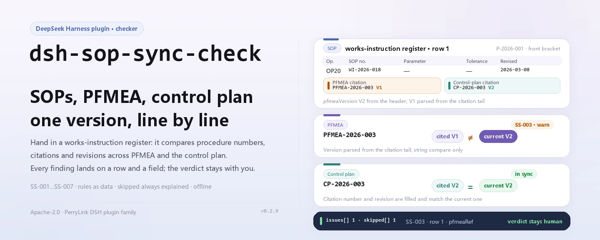
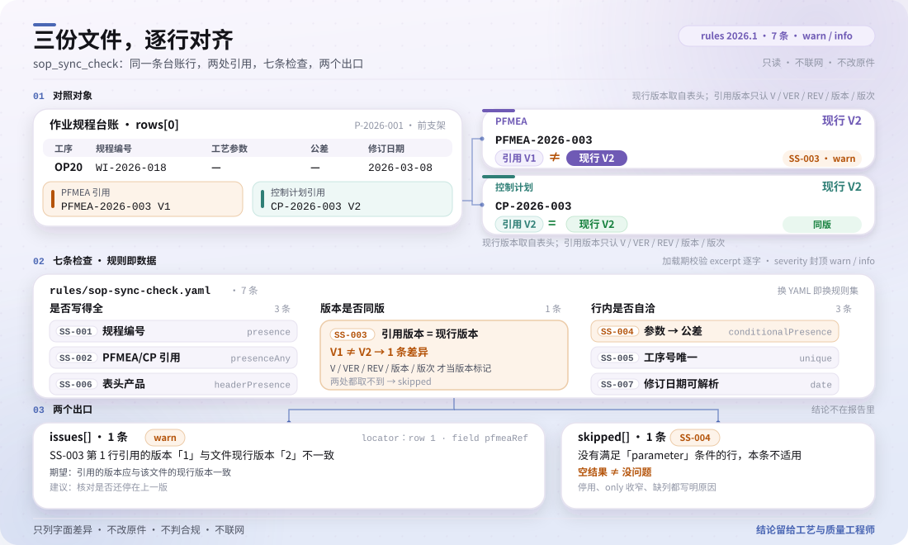

<div align="center">

<picture>
  <source media="(prefers-color-scheme: dark)" srcset="docs/assets/dsh-sop-sync-check-hero-en-dark.webp">
  
</picture>

# dsh-sop-sync-check

**कार्य-अनुदेश रजिस्टर को उसके द्वारा उद्धृत PFMEA और नियंत्रण योजना से मिलाएँ — और जानें कौन-सी पंक्ति, कौन-सा कॉलम, क्या अंतर है।**

प्रक्रिया, गुणवत्ता और दस्तावेज़-नियंत्रण कार्य के लिए एक मिलान-उपकरण: एक कार्य-अनुदेश रजिस्टर दें, और यह उसे संस्करणबद्ध नियम-पैक से यांत्रिक रूप से तुलना करके पंक्ति-दर-पंक्ति इंगित करने योग्य अंतरों की सूची लौटाता है। यह मूल दस्तावेज़ को बदलता नहीं और अनुपालन पर निर्णय नहीं देता।

[इंस्टॉल](#तीन-चरणों-में-शुरुआत) · [कॉन्फ़िगरेशन](#कॉन्फ़िगरेशन) · [FAQ](#faq) · [简体中文](README.md) · [English](README.en.md) · [Español](README.es.md) · [Português](README.pt.md) · [हिन्दी](README.hi.md)

[](LICENSE)
[](#अनुकूलता)
[](https://www.npmjs.com/package/dsh-sop-sync-check)
[](https://github.com/PerryLink/dsh-sop-sync-check/actions/workflows/ci.yml)
[](#अनुकूलता)

[](https://github.com/PerryLink/dsh-sop-sync-check/stargazers)
[](https://www.npmjs.com/package/dsh-sop-sync-check)
[](https://dshfind.com/plugins/PerryLink/dsh-sop-sync-check?ref=badge)
[](https://securityscorecards.dev/viewer/?uri=github.com/PerryLink/dsh-sop-sync-check)
[](https://dsh.market/)
[](https://gitee.com/perrylink/dsh-sop-sync-check)

```sh
dsh plugin --profile <name> add dsh-sop-sync-check
```

</div>

<sub>समुदाय प्लगइन, DeepSeek से संबद्ध नहीं। मुख्य रेपो: <https://github.com/PerryLink/dsh-sop-sync-check> (Gitee प्रतिबिंब है)।</sub>

## यह क्या है

`dsh-sop-sync-check` एक कार्य-अनुदेश रजिस्टर पढ़ता है — उत्पाद हेडर और प्रत्येक प्रक्रिया की एक पंक्ति — और उस रजिस्टर की उसके द्वारा उद्धृत PFMEA तथा नियंत्रण योजना के साथ यांत्रिक संगति जाँचता है: हर प्रक्रिया पंक्ति में प्रक्रिया-अनुदेश क्रमांक दर्ज है या नहीं, PFMEA या नियंत्रण योजना का उल्लेख है या नहीं, पंक्ति में उद्धृत संस्करण रजिस्टर में दर्ज वर्तमान संस्करण से मेल खाता है या नहीं, दर्ज किए गए पैरामीटर के साथ सह्यता (tolerance) दर्ज है या नहीं, कोई प्रक्रिया क्रमांक दोहराया नहीं गया है या नहीं, हेडर उत्पाद बताता है या नहीं, और संशोधन तिथि पढ़ी जा सकती है तथा जाँच-तिथि से बाद की नहीं है या नहीं। यह नहीं आँकता कि प्रक्रिया पैरामीटर सही हैं, नियंत्रण योजना सभी विफलता-प्रकारों को समेटती है, या PFMEA विश्लेषण पर्याप्त है; जो जाँच चल नहीं सकती वह चुपचाप पास होने के बजाय `skipped` में दर्ज होती है।

यह उन लोगों के लिए है जो प्रक्रिया, गुणवत्ता और दस्तावेज़-नियंत्रण का काम करते हैं और जिन्हें कमांड लाइन छूने की ज़रूरत नहीं होनी चाहिए: जाँच के लिए आवश्यक मूल सामग्री — तालिका, रजिस्टर या दस्तावेज़ — दें, मूल कभी नहीं बदला जाता। Excel को पहले JSON/YAML में बदला जा सकता है, चैट में भी यदि प्लेटफ़ॉर्म साथ दे।

```text
सामग्री (JSON / YAML) ──▶ sop_sync_check ──▶ rules/sop-sync-check.yaml ──▶ रिपोर्ट
                                                                    └─▶ skipped (न चल पाई जाँच + कारण)
```

<picture>
  <source media="(prefers-color-scheme: dark)" srcset="docs/assets/dsh-sop-sync-check-flow-v5-dark.svg">
  
</picture>

## तीन चरणों में शुरुआत

1. **इंस्टॉल करें** (एक चैनल चुनें):

   ```sh
   # git चैनल (नवीनतम main)
   dsh plugin --profile <name> add github:PerryLink/dsh-sop-sync-check
   # npm चैनल (प्रकाशित संस्करण, अभी 0.2.9)
   dsh plugin --profile <name> add dsh-sop-sync-check
   # tarball चैनल: इस रेपो में pnpm pack के बाद
   dsh plugin --profile <name> add ./dsh-sop-sync-check-<version>.tgz
   ```

   यह WorkBuddy / Coze पर «Professional Document Check Suite» का भी हिस्सा है (पूरा सेट; यह जाँच उसका एक भाग है; उपलब्धता हर मार्केटप्लेस के अनुसार)।

2. **न्यूनतम सामग्री** (JSON या YAML; एक हेडर और प्रत्येक प्रक्रिया की एक पंक्ति):

   ```yaml
   productNo: P-2026-001
   productName: 前支架
   rows:
     - { 规程编号: WI-2026-018, 工序号: OP20, 工序名称: 精车外圆,
         工艺参数: 主轴转速 1200 r/min, 参数公差: ±50 r/min,
         PFMEA编号: PFMEA-2026-003 V2, PFMEA现行版本: V2,
         控制计划编号: CP-2026-003 V2, 控制计划现行版本: V2, 修订日期: 2026-03-08 }
   ```

3. **जाँचें कि सक्रिय है**:

   ```sh
   dsh --profile <name> --dump-config | grep 'dsh-sop-sync-check'
   ```

   फिर मॉडल से `sop_sync_check` कहलवाएँ और ऊपर की सामग्री `file` या `material` के रूप में दें। होस्ट के बिना भी रेपो का नमूना चल सकता है:

   ```sh
   pnpm install
   pnpm run build
   node samples/quickstart/run.mjs --json
   ```

   आउटपुट `samples/quickstart/expected/result.json` से मेल खाता है (`issueCount: 2`, `warn: 2`, `skippedCount: 1`); एक पंक्ति का सारांश चाहिए तो `--json` हटा दें। टर्मिनल स्क्रीनशॉट: [`docs/assets/quickstart.png`](docs/assets/quickstart.png)।

**अनइंस्टॉल**: `dsh plugin --profile <name> remove dsh-sop-sync-check` (या प्रोफ़ाइल पैच से वह पंक्ति हटा दें)।

## मुख्य क्षमताएँ

नियम-पैक डेटा है: `rules/sop-sync-check.yaml` हर जाँच घोषित करता है, इसलिए वह फ़ाइल बदलने से TypeScript छुए बिना नियम-समुच्चय का संस्करण बदल जाता है। पैक लोड के समय सत्यापित होता है, उस पर भरोसा नहीं किया जाता; हर निष्कर्ष पंक्ति और कॉलम, जो मिला, जो अपेक्षित था और सुधार का संकेत देता है।

| नियम | जाँच | गंभीरता | आधार-प्रकार |
|---|---|---|---|
| `SS-001` | हर प्रक्रिया प्रक्रिया-अनुदेश क्रमांक बताती है | warn | सिद्धांत |
| `SS-002` | प्रक्रिया अपने PFMEA या नियंत्रण योजना का उल्लेख करती है | warn | सिद्धांत |
| `SS-003` | उद्धृत संस्करण दस्तावेज़ के वर्तमान संस्करण से मेल खाता है | warn | सिद्धांत |
| `SS-004` | दर्ज पैरामीटर के साथ सह्यता दर्ज है | warn | सिद्धांत |
| `SS-005` | प्रक्रिया क्रमांक अद्वितीय हैं | warn | सिद्धांत |
| `SS-006` | रजिस्टर अपना उत्पाद बताता है | warn | सिद्धांत |
| `SS-007` | संशोधन तिथि पढ़ी जा सकती है और भविष्य की नहीं है | warn | सिद्धांत |

- **पंक्ति और कॉलम तक पहुँचने योग्य।** रिपोर्ट का `locator` `row` और `field` देता है; `found` / `expected` / `fix` बताते हैं कि क्या दिखा, क्या अपेक्षित था और कैसे सुधारें — निर्णय मनुष्य का ही रहता है।
- **खाली परिणाम प्रमाण-पत्र नहीं है।** जो भी जाँच चल नहीं सकी वह कारण के साथ `skipped` में जाती है, और बंद किया गया नियम भी चुपचाप गायब होने के बजाय वहीं दिखता है।
- **केवल शाब्दिक तुलना।** यह नहीं आँकता कि पैरामीटर उचित हैं, नियंत्रण योजना सभी विफलता-प्रकारों को समेटती है या PFMEA विश्लेषण पर्याप्त है, और अनुपालन, दायित्व या शुद्धता पर कोई निर्णय नहीं देता।
- **संस्करण-पाठ को स्पष्ट संकेत चाहिए।** `SS-003` केवल `V`, `VER`, `REV` या संस्करण/संशोधन-शब्द के बाद आने वाले पाठ को संस्करण मानता है, इसलिए दस्तावेज़ क्रमांक के अंत के अंक कभी संस्करण नहीं समझे जाते।

### उपकरण सतह

| तर्क | आवश्यक | अर्थ |
|---|---|---|
| `file` | दोनों में से एक | सामग्री फ़ाइल का पथ (JSON या YAML) |
| `material` | दोनों में से एक | इनलाइन सामग्री पाठ (JSON या YAML) |
| `rulesFile` | नहीं | कॉन्फ़िगर किया गया नियम-पैक पथ बदलें (पैकेज के सापेक्ष या निरपेक्ष) |
| `only` | नहीं | केवल ये नियम चलाएँ; खाली होने पर सभी (कॉन्फ़िग के `onlyRules` के साथ) |

### उदाहरण

नीचे दिया गया आउटपुट इस प्लगइन का अपने ही `SS-003` फ़िक्स्चर पर वास्तविक आउटपुट है, कोई चित्रण नहीं। नियम-पैक उद्धरण नहीं गढ़ता, इसलिए हर निष्कर्ष लागू किए गए खंड का नाम और यह भी बताता है कि उसका मूल पाठ इस बार प्राप्त नहीं हुआ।

**उपकरण** `sop_sync_check`

**इनपुट**

```json
{"pfmeaVersion":"V2","rows":[{"PFMEA编号":"PFMEA-2026-003 V1"}]}
```

**आउटपुट**

```json
{
  "id": "dsh-sop-sync-check.SS-003.de09b5a6",
  "ruleId": "SS-003",
  "severity": "warn",
  "locator": {
    "row": 1,
    "field": "pfmeaRef"
  },
  "found": "第 1 行引用的版本「1」与文件现行版本「2」不一致",
  "expected": "引用的版本应与该文件的现行版本一致",
  "fix": "核对是否还停在上一版；本条只比对版本串，不判断该引用应当指向哪一版"
}
```

*Observed from `dsh-sop-sync-check/tests/fixtures/SS-003/SS-003-unsafe.json`*

नियम-दर-नियम:

| आपका सवाल | इसका जवाब |
|---|---|
| किसी प्रक्रिया पंक्ति के प्रक्रिया-अनुदेश क्रमांक वाला कॉलम खाली है। | `SS-001` उस पंक्ति को दर्ज करता है: नियम चाहता है कि जिस भी पंक्ति में यह कॉलम मौजूद है उसमें क्रमांक भरा हो, और यह केवल उपस्थिति देखता है — यह नहीं कि वह प्रक्रिया-अनुदेश उसी प्रक्रिया का सही अनुदेश है। यदि सामग्री में यह कॉलम ही न हो, तो नियम चुपचाप पास होने के बजाय बताता है कि वह लागू नहीं होता। |
| यह कार्य-अनुदेश किस PFMEA और किस नियंत्रण योजना का है, यह कहीं दर्ज नहीं है। | `SS-002` हर पंक्ति में PFMEA-संदर्भ और नियंत्रण-योजना-संदर्भ वाले कॉलमों में से कम से कम एक भरा होने की अपेक्षा करता है। यह केवल देखता है कि कम से कम एक उद्धृत है — यह नहीं कि उद्धरण उपयुक्त है, और यह भी नहीं कि उसमें लिखा संस्करण वर्तमान है; वह तुलना `SS-003` करता है। |
| प्रक्रिया-अनुदेश में अब भी PFMEA का पिछला संस्करण उद्धृत है। क्या यह पकड़ में आता है? | हाँ। `SS-003` संस्करण अलग कॉलम से, या उद्धरण-पाठ के अंत में लगे संस्करण-चिह्न से लेता है (`PFMEA-2026-003 V2`); चिह्न के लिए `V`, `VER`, `REV` या संस्करण/संशोधन-शब्द जैसा स्पष्ट संकेत ज़रूरी है, इसलिए दस्तावेज़ क्रमांक के अंत के अंकों को संस्करण नहीं मान लिया जाता। जिस उद्धरण का संस्करण-पाठ दस्तावेज़ के वर्तमान संस्करण से भिन्न है, वह पंक्ति दर्ज होती है, और यह केवल संस्करण-पाठ की तुलना करता है — यह नहीं तय करता कि उद्धरण किस संस्करण की ओर होना चाहिए। न संस्करण कॉलम हो न पढ़ने योग्य संस्करण-पाठ, तो यह नियम स्वयं को `skipped` में दर्ज करता है। |
| पैरामीटर कॉलम भरा है, पर सह्यता कॉलम खाली है। | `SS-004` उस पंक्ति को दर्ज करता है, पर केवल तब जब पैरामीटर कॉलम भरा हो, इसलिए जिस प्रक्रिया में वास्तव में कोई पैरामीटर नहीं है वह पंक्ति दर्ज नहीं होती। यह देखता है कि सह्यता कॉलम भरा है, यह नहीं कि पैरामीटर और उसकी सह्यता उचित हैं। |
| एक ही प्रक्रिया क्रमांक दो पंक्तियों में आया है। | `SS-005` दोहराया गया प्रक्रिया क्रमांक दर्ज करता है और बताता है कि वह पहली बार किस पंक्ति में आया; तुलना करते समय खाली स्थान छोड़ दिए जाते हैं। दोहराव का अर्थ आम तौर पर दोहरा पंजीकरण या क्रमांक की चूक है — कौन-सी पंक्ति सही है, यह मनुष्य का निर्णय रहता है। प्रक्रिया क्रमांक का कॉलम ही न हो तो नियम पास होने के बजाय बताता है कि वह लागू नहीं होता। |
| एक संशोधन तिथि `2026/3/8` लिखी है और एक पंक्ति में अगले महीने की तिथि है। | `SS-007` उस संशोधन तिथि को दर्ज करता है जिसे वह तिथि के रूप में नहीं पढ़ सकता, और उस तिथि को भी जो जाँच-तिथि के बाद पड़ती है। यह देखता है कि तिथि पढ़ी जा सके और जाँच-तिथि के बाद न पड़े; यह नहीं आँकता कि संशोधन समय पर हुआ या नहीं। |

## कॉन्फ़िगरेशन

सभी समायोज्य पैरामीटर `src/config.ts` की Schemastery स्कीमा में हैं, इसलिए कोड बदले बिना `cordis.yml` से बदले जा सकते हैं; प्रति-नियम सीमाएँ `rules/` के नियम-पैक में हैं।

| कुंजी | प्रकार | डिफ़ॉल्ट | विवरण |
|---|---|---|---|
| `rulesFile` | string | `rules/sop-sync-check.yaml` | नियम-पैक का पथ, पैकेज रूट के सापेक्ष |
| `disabledRules` | string[] | `[]` | बंद करने वाले नियम id; प्रत्येक `skipped` में दिखता है |
| `onlyRules` | string[] | `[]` | केवल ये नियम चलाएँ; खाली होने पर सभी नियम चलते हैं |
| `skipNotes` | string | `""` | हर `skipped` कारण के आगे जोड़ी जाने वाली टिप्पणी |
| `timeoutMs` | number | `120000` | उपकरण का सहकारी समय-सीमा बजट |

<details>
<summary>नियम-स्तरीय पैरामीटर (SS-003 / SS-004)</summary>

- `SS-003` में `referenceField` / `actualVersionField` / `sameVersionField` तय करते हैं कि उद्धृत संस्करण और दस्तावेज़ का वर्तमान संस्करण किस कॉलम से आते हैं। `actualVersionField` सूची हो सकता है; पहला गैर-रिक्त उम्मीदवार जीतता है, और नंगा संस्करण (`V2`) तथा संस्करण लिए उद्धरण (`PFMEA-2026-003 V2`) दोनों काम करते हैं। यदि रजिस्टर उद्धृत संस्करण को अपने अलग कॉलम में रखता है, उसे `sameVersionField` में लिखें।
- `SS-004` में `conditionField` / `requiredFields` तय करते हैं कि कौन-सा कॉलम आवश्यकता शुरू करता है और उसे क्या चाहिए।

ये फ़ील्ड नियम-पैक फ़ाइल में रहते हैं और `config.ts` की पाँच रनटाइम कुंजियों से अलग हैं: एक नियम बदलते हैं, दूसरी डिप्लॉयमेंट व्यवहार।

</details>

प्रोफ़ाइल पैच में बदलाव का उदाहरण:

```yaml
- insert:
    - id: dsh-sop-sync-check
      name: dsh-sop-sync-check
      config:
        onlyRules: [SS-001, SS-003, SS-005]
        skipNotes: संस्थागत कार्यान्वयन नियम v3
        timeoutMs: 60000
```

## FAQ

<details>
<summary>सामग्री कहाँ जाती है? कुछ संग्रहीत होता है?</summary>

कहीं नहीं: कोई नेटवर्क नहीं, कोई मॉडल कॉल नहीं, कोई फ़ाइल लेखन नहीं। प्लगइन केवल वह फ़ाइल पढ़ता है जो आप `file` में देते हैं या वह इनलाइन पाठ जो `material` में देते हैं, उसे उसी प्रक्रिया में पढ़ता और तुलना करता है, और रिपोर्ट वर्तमान सत्र को लौटाता है। रेपो में न नेटवर्क कोड है न क्रेडेंशियल कॉन्फ़िगरेशन।

</details>

<details>
<summary>यदि कोई नियम नहीं चला, तो क्या उसे «कोई समस्या नहीं» पढ़ा जा सकता है?</summary>

नहीं। हर वह जाँच जो चल नहीं सकी — कॉलम अनुपस्थित, कोई तुलनीय संस्करण-पाठ नहीं, नियम बंद — अपने id और कारण के साथ `skipped` में सूचीबद्ध होती है, और `config.skipNotes` हर प्रविष्टि के आगे संस्थागत टिप्पणी जोड़ सकता है। खाली समस्या-सूची का अर्थ केवल यह है कि जो जाँचें चल सकीं उनमें कोई अंतर नहीं मिला; इसका अर्थ यह नहीं कि सामग्री निर्दोष है।

</details>

<details>
<summary>क्या यह मेरी ओर से अनुपालन या दायित्व तय करता है?</summary>

नहीं। यह केवल सामग्री के भीतर इंगित करने योग्य शाब्दिक अंतर सूचीबद्ध करता है, मनुष्य की समीक्षा के लिए, और रिपोर्ट में अस्वीकरण रहता है; यह अनुपालन, दायित्व या शुद्धता पर कोई निर्णय नहीं देता। प्रक्रिया पैरामीटर उचित हैं या नहीं, नियंत्रण योजना सभी विफलता-प्रकारों को समेटती है या नहीं, और PFMEA विश्लेषण पर्याप्त है या नहीं — ये प्रक्रिया और गुणवत्ता इंजीनियरों के निर्णय हैं।

</details>

<details>
<summary>क्या यह दूसरे प्लगइनों से टूल नाम या इवेंट पर टकराएगा?</summary>

यह ठीक एक टूल, `sop_sync_check` (`inject: ['tools']`) पंजीकृत करता है, और कोई कमांड, क्लाइंट स्लॉट, HTTP रूट या सेवा कुंजी पंजीकृत नहीं करता। पंजीकरण Cordis effect है: अनलोड या हॉट-रीलोड पर हट जाता है।

</details>

<details>
<summary>प्रदर्शन पर कितना खर्च है?</summary>

शुद्ध स्ट्रिंग और तालिका कार्य, कोई नेटवर्क नहीं, कोई मॉडल कॉल नहीं। डिफ़ॉल्ट सहकारी समय-सीमा बजट `timeoutMs: 120000` है, जिसे टूल-निष्पादन ढाँचा लागू करता है। एक रजिस्टर एक ही कॉल में जाँचा जाता है; बहुत सी सामग्री के बैच के लिए `ptc` टूल मोड चुनें, जिससे स्कीमा खर्च एक बार चुकाया जाता है।

</details>

## मानक और उद्धरण-सीमाएँ

यह नियम-पैक किसी सार्वजनिक मानक का उद्धरण नहीं देता: सत्यापन को IATF 16949 और ऑटोमोटिव कोर-टूल्स पुस्तिकाओं का शब्दशः खंड-पाठ नहीं मिला, इसलिए हर नियम का `basis` यही बात स्पष्ट लिखता है, सभी `derived-from-principle` हैं और कोई भी `warn` से ऊपर नहीं जाता। जाँचें जिन पर टिकती हैं वे हैं रजिस्टर का अपना लिखा क्रमांक और संस्करण — उसके कॉलम में लिखा प्रक्रिया-अनुदेश क्रमांक, PFMEA या नियंत्रण योजना के उद्धरण के साथ दर्ज संस्करण, पैरामीटर के पास लिखी सह्यता, संशोधन तिथि — और उनकी आपसी तुलना।

| दस्तावेज़ | संख्यांक | इन्हें उद्धृत करने वाले नियम |
|---|---|---|
| IATF 16949 / ऑटोमोटिव कोर-टूल्स पुस्तिकाएँ | वर्तमान संस्करण और खंड-संख्या इस बार सत्यापित नहीं | SS-001, SS-002, SS-003, SS-004, SS-005, SS-006, SS-007 |

**सीमा:** यह प्लगइन एक **कार्य-अनुदेश रजिस्टर** की उसके **PFMEA** और **नियंत्रण योजना** के साथ यांत्रिक संगति जाँचता है — कि क्रमांक दर्ज है, PFMEA और नियंत्रण योजना उद्धृत हैं, उद्धृत संस्करण दस्तावेज़ के वर्तमान संस्करण से मेल खाता है, पैरामीटर के साथ सह्यता है, प्रक्रिया क्रमांक अद्वितीय हैं, रजिस्टर अपना उत्पाद बताता है, और संशोधन तिथियाँ पढ़ी जा सकती हैं। यह **नहीं** आँकता कि प्रक्रिया पैरामीटर सही हैं, नियंत्रण योजना सभी विफलता-प्रकारों को समेटती है, या PFMEA विश्लेषण पर्याप्त है। **ये प्रक्रिया और गुणवत्ता इंजीनियरों के निर्णय हैं।**

> ### ⚠️ रिपोर्ट के किसी उद्धरण पर भरोसा करने से पहले यह पढ़ें
>
> **इस प्लगइन के नियम-पैक का हर `excerpt` स्पष्ट लिखता है कि खंड-पाठ इस बार प्राप्त नहीं हुआ।** यह व्यवस्था IATF 16949 और ऑटोमोटिव कोर-टूल्स पुस्तिकाओं (APQP, PFMEA, नियंत्रण योजना) में है। सत्यापन उनसे शब्दशः खंड-पाठ नहीं ला सका, इसलिए पैक ने किसी उद्धरण को तोड़-मरोड़ कर लिखने के बजाय यह कमी `excerpt` फ़ील्ड में ही लिख दी और ईमानदार तर्क `note` में रख दिया। इसलिए हर नियम `warn` या `info` है, और एक टेस्ट यह प्रमाणित करता है कि कोई नियम ऐसा उद्धरण नहीं दावा करता जो उसके पास नहीं है। **पाठ हाथ में आने पर दो काम करने होंगे: हर `excerpt` को असली खंड से बदलें और `kind` को `direct` तक बढ़ाएँ।**
>
> `SS-003` ही अपना मूल्य कमाता है: **प्रक्रिया-अनुदेश में अब भी PFMEA का पिछला संस्करण उद्धृत होना** वह सबसे सामान्य और सबसे खतरनाक तरीका है जिससे तीनों दस्तावेज़ अलग-अलग हो जाते हैं। यह संस्करण अलग कॉलम से या उद्धरण-पाठ के अंत में लगे संस्करण-चिह्न (`PFMEA-2026-003 V2`) से लेता है, और उसे `V`, `VER`, `REV` या संस्करण/संशोधन-शब्द जैसा स्पष्ट संकेत चाहिए ताकि *दस्तावेज़ क्रमांक* के अंत के अंक कभी संस्करण न समझे जाएँ। दोनों स्रोत उपलब्ध न हों तो यह स्वयं को `skipped` में दर्ज करता है।

## सामग्री प्रारूप

JSON या YAML स्वीकार्य है। पढ़ने की परत में फ़ील्ड वैकल्पिक हैं और जाँच इंजन उन्हें सत्यापित करता है, इसलिए आंशिक निर्यात पर क्रैश के बजाय «अनुपस्थित» श्रेणी के निष्कर्ष मिलते हैं।

```yaml
productNo: P-2026-001
productName: 前支架
rows:
  - { 规程编号: WI-2026-018, 工序号: OP20, 工序名称: 精车外圆,
      工艺参数: 主轴转速 1200 r/min, 参数公差: ±50 r/min,
      PFMEA编号: PFMEA-2026-003 V2, PFMEA现行版本: V2,
      控制计划编号: CP-2026-003 V2, 控制计划现行版本: V2, 修订日期: 2026-03-08 }
```

कॉलम नाम बड़े/छोटे अक्षर का भेद किए बिना और खाली स्थान, अंडरस्कोर तथा हाइफ़न छोड़कर मिलाए जाते हैं; रजिस्टर के अपने कॉलम नाम सुरक्षित रहते हैं, इसलिए हर निष्कर्ष उसी कॉलम का नाम लेता है जो आपने लिखा। हेडर `productNo`, `productName` तथा PFMEA / नियंत्रण योजना के वर्तमान संस्करण ले सकता है; ऊपर का उदाहरण वे चीनी कॉलम शीर्षक दिखाता है जिन्हें पाठक स्वीकार करता है। तिथियाँ `2026-03-08` या `2026-03-08 09:30` हो सकती हैं।

## नियम-स्रोत

नियम-डेटा कोड से अलग है: पैक का हेडर उद्धरण-अंतराल पूरा बताता है और हर नियम का `note` उससे जुड़ा हिस्सा दोहराता है। प्रत्येक नियम में दस्तावेज़, संख्या, स्रोत की अपनी क्रमांकन-प्रणाली के अनुसार धारा, शब्दशः उद्धरण और स्रोत URL होता है। लोडर लागू करता है कि उद्धरण कम से कम आठ अक्षरों का वास्तविक उद्धरण हो, और जिस जाँच का आधार केवल सामान्य सिद्धांत (`kind: derived-from-principle`, अधिकतम `warn`) या स्थानीय नीति (`kind: institutional-configuration`, अधिकतम `info`) हो, उसे कभी `error` घोषित न किया जाए। वह नियंत्रण उद्धरण और विवरण में भेद नहीं कर सकता, इसलिए यह पैक अपने हेडर, प्रति-नियम टिप्पणियों और एक टेस्ट पर टिकता है जो प्रमाणित करता है कि हर `excerpt` इस अंतराल को स्वीकार करता है; अपने आधार को बढ़ा-चढ़ाकर बताने वाला पैक लोड पर ही विफल होता है, प्रभावशाली दिखने वाली रिपोर्ट नहीं बनाता।

सत्यापित सीमाएँ और जान-बूझकर **न** कहे गए निष्कर्ष पैकेज में शामिल `rules/evidence/` निर्देशिका में हैं।

## अनुकूलता

| सतह | स्थिति |
|---|---|
| Harness | peer रेंज `>=0.1.2-rc.1 <0.2.0 \|\| >=0.2.0-0 <0.3.0` — `0.2.0-rc.2` और `0.2.1-rc.2` दोनों को स्वीकार करने के लिए सत्यापित। `engines.dsh` `>=0.2.1-0 <0.3.0` के रूप में घोषित है और 0.2.1 से होस्ट इसे लागू करता है |
| Node | `^22.19.0 \|\| >=24.0.0` |
| प्लेटफ़ॉर्म | सभी (शुद्ध ESM; कोई नेटिव कोड नहीं, कोई नेटवर्क नहीं, कोई मॉडल कॉल नहीं) |
| टूल मोड | `native` और `ptc` में काम करता है; पूरे कार्य-अनुदेश समुच्चय के लिए `ptc` चुनें |

## समस्या-निवारण

- **प्लगइन इंस्टॉल हो गया पर टूल दिखता नहीं।** जाँचें कि `main` `lib/index.mjs` पर जाता है और `pnpm run build` ने उसे बनाया है; गलत `main` पर लोडर प्रविष्टि को चुपचाप छोड़ देता है।
- **`dsh plugin add` असंगत बताकर मना करता है।** peer रेंज `0.1.x` और `0.2.x` दोनों को कवर करती है; यदि आपका रनटाइम उसके बाहर है तो स्पष्ट छूट दें: `dsh plugin --profile <name> allow-version dsh-sop-sync-check@0.2.9 --dsh-version <runtime> --accept-risk`।
- **कोई नियम नहीं चला।** `skipped` सरणी पढ़ें: वह नियम id और कारण बताती है।
- **`SS-003` स्वयं को छोड़ा हुआ बताता है।** न उद्धृत संस्करण पढ़ा जा सका न दस्तावेज़ का वर्तमान संस्करण। रजिस्टर में वर्तमान संस्करण का अलग कॉलम जोड़ें (पाठक दस्तावेज़ित उपनाम स्वीकार करता है), या संस्करण को उद्धरण-पाठ के अंत में `V2` की तरह लिखें।
- **`SS-003` नहीं चलता जबकि मुझे पता है संस्करण अलग हैं।** कॉलम हल करने का क्रम देखें: `actualVersionField` पहला गैर-रिक्त उम्मीदवार लेता है, इसलिए पहले लिखा पुराना कॉलम बाद वाले को ढक देता है।
- **`SS-003` बिना संस्करण वाले उद्धरण पर भी चलता है।** यही जाँच है — जो उद्धरण नहीं बताता कि वह किस संस्करण पर है, उसकी तुलना नहीं हो सकती।
- **`SS-004` बिना सह्यता वाली प्रक्रिया पर चलता है।** या तो पैरामीटर वाकई है और सह्यता छूटी है, या प्रक्रिया में कोई पैरामीटर नहीं है और पैरामीटर कॉलम खाली रहना चाहिए।
- **`check` में `manifest-peers` विफल दिखता है।** स्थिर जाँचकर्ता 0.2 पंक्ति से पहले के हार्डकोडेड peer रेंज से तुलना करता है; रनटाइम इंस्टॉल के समय अनुकूलता लागू करता है, इसलिए घोषित रेंज सही है। यह `dsh-plugin-dev` की ज्ञात अपस्ट्रीम समस्या है।
- **समय खिसका हुआ लगता है।** सारी गणना दिए गए स्ट्रिंग पर वॉल-क्लॉक है; कोई समय-क्षेत्र रूपांतरण नहीं होता।

## पारिस्थितिकी और गुणवत्ता

- [Gitee प्रतिबिंब](https://gitee.com/perrylink/dsh-sop-sync-check) (समकालिक प्रतिबिंब; GitHub मुख्य है)
- [dshfind प्लगइन पृष्ठ](https://dshfind.com/plugins/PerryLink/dsh-sop-sync-check) (इंस्टॉल और रैंकिंग)
- [OpenSSF Scorecard रिपोर्ट](https://securityscorecards.dev/viewer/?uri=github.com/PerryLink/dsh-sop-sync-check) ([.github/workflows/scorecard.yml](.github/workflows/scorecard.yml) से संचालित)
- [DSH Market](https://dsh.market/) (सूचीबद्ध)
- [सामग्री के अनुसार जाँचकर्ता चुनें](https://perrylink.github.io/zh/checkers/choose/) (परिवार सूचकांक: 62 जाँचकर्ता और सामान्य प्लगइन)

## विकास

```sh
pnpm install
pnpm run typecheck   # tsc --noEmit
pnpm test            # vitest, साझा टेबल-प्लगइन सूट और युग्मित फ़िक्स्चर
pnpm run build       # tsdown -> lib/index.mjs + lib/index.d.mts
node ../scripts/sync-shared.mjs dsh-sop-sync-check   # src/shared ताज़ा करें
pnpm run check:readmes                               # पाँच-भाषा README संगति
```

आइटम 5 `../_shared` का साझा किट `src/shared/` में कॉपी करता है; हर साझा बदलाव के बाद इसे दोबारा चलाएँ।

प्लगइन **डेटा-चालित** है: `src/model.ts` तालिका का आकार और कॉलम उपनाम घोषित करता है, `src/shared/` पाठक और जाँच इंजन देता है, और नियम-पैक हर जाँच घोषित करता है। README की तस्वीरें [`scripts/gen-readme-assets.py`](scripts/gen-readme-assets.py) से क्रमादेशित रूप से बनती हैं — hero बैनर Pillow से और flow-v5 संरचना-चित्र हाथ से लिखे SVG से — और दोबारा चलाई जा सकती हैं।

Topics: `dsh`, `dsh-plugin`, `deepseek-harness`, `deepseek`, `cordis`, `sop`, `sync`

## परिवार और आभार

यह परियोजना [PerryLink](https://github.com/PerryLink) की DeepSeek Harness प्लगइन परिवार की सदस्य है (सभी Apache-2.0)। अगर यह उपयोगी लगे तो **एक स्टार अगले व्यक्ति को इसे खोजने में मदद करता है** — इसके पीछे कुछ भी बंद नहीं है।

- [@PerryLink](https://github.com/PerryLink) — निर्माता और अनुरक्षक: नियम-पैक डिज़ाइन, तालिका पाठक और जाँच इंजन, `sop_sync_check` उपकरण तथा पाँच-भाषा दस्तावेज़।

<details>
<summary>सभी प्लगइन दिखाएँ</summary>

| प्लगइन | स्थिति |
|---|---|
| **[dsh-aqua-input-check](https://github.com/PerryLink/dsh-aqua-input-check)** |  |
| **[dsh-archive-check](https://github.com/PerryLink/dsh-archive-check)** |  |
| **[dsh-auto-review](https://github.com/PerryLink/dsh-auto-review)** |  |
| **[dsh-autotier](https://github.com/PerryLink/dsh-autotier)** | 🧊 फ़्रोज़न — रेपो README देखें |
| **[dsh-bid-ca-precheck](https://github.com/PerryLink/dsh-bid-ca-precheck)** |  |
| **[dsh-bid-qual-check](https://github.com/PerryLink/dsh-bid-qual-check)** |  |
| **[dsh-cert-mcp](https://github.com/PerryLink/dsh-cert-mcp)** | 🧊 फ़्रोज़न — रेपो README देखें |
| **[dsh-checkpoint-rewind](https://github.com/PerryLink/dsh-checkpoint-rewind)** |  |
| **[dsh-click](https://github.com/PerryLink/dsh-click)** |  |
| **[dsh-composer-history](https://github.com/PerryLink/dsh-composer-history)** |  |
| **[dsh-contract-stance](https://github.com/PerryLink/dsh-contract-stance)** |  |
| **[dsh-customs-doc-check](https://github.com/PerryLink/dsh-customs-doc-check)** |  |
| **[dsh-data-quality](https://github.com/PerryLink/dsh-data-quality)** |  |
| **[dsh-demurrage-ledger](https://github.com/PerryLink/dsh-demurrage-ledger)** |  |
| **[dsh-doublecheck](https://github.com/PerryLink/dsh-doublecheck)** |  |
| **[dsh-drill-script-check](https://github.com/PerryLink/dsh-drill-script-check)** |  |
| **[dsh-eia-guide-check](https://github.com/PerryLink/dsh-eia-guide-check)** |  |
| **[dsh-emergency-plan](https://github.com/PerryLink/dsh-emergency-plan)** |  |
| **[dsh-essay-rubric-check](https://github.com/PerryLink/dsh-essay-rubric-check)** |  |
| **[dsh-evidence-check](https://github.com/PerryLink/dsh-evidence-check)** |  |
| **[dsh-export-ctl-check](https://github.com/PerryLink/dsh-export-ctl-check)** |  |
| **[dsh-fast](https://github.com/PerryLink/dsh-fast)** |  |
| **[dsh-fmea-table-check](https://github.com/PerryLink/dsh-fmea-table-check)** |  |
| **[dsh-forecast-penalty](https://github.com/PerryLink/dsh-forecast-penalty)** |  |
| **[dsh-fund-research](https://github.com/PerryLink/dsh-fund-research)** |  |
| **[dsh-github](https://github.com/PerryLink/dsh-github)** |  |
| **[dsh-gongwen-flow-check](https://github.com/PerryLink/dsh-gongwen-flow-check)** |  |
| **[dsh-gongwen-word-check](https://github.com/PerryLink/dsh-gongwen-word-check)** |  |
| **[dsh-guard-plan-qc](https://github.com/PerryLink/dsh-guard-plan-qc)** |  |
| **[dsh-hazchem-check](https://github.com/PerryLink/dsh-hazchem-check)** |  |
| **[dsh-hazplan-check](https://github.com/PerryLink/dsh-hazplan-check)** |  |
| **[dsh-hidden-risk-map](https://github.com/PerryLink/dsh-hidden-risk-map)** |  |
| **[dsh-hs-classify](https://github.com/PerryLink/dsh-hs-classify)** |  |
| **[dsh-icd-rule-check](https://github.com/PerryLink/dsh-icd-rule-check)** |  |
| **[dsh-industry-research](https://github.com/PerryLink/dsh-industry-research)** |  |
| **[dsh-lawcite-adapter](https://github.com/PerryLink/dsh-lawcite-adapter)** |  |
| **[dsh-laya](https://github.com/PerryLink/dsh-laya)** |  |
| **[dsh-lc-doc-check](https://github.com/PerryLink/dsh-lc-doc-check)** |  |
| **[dsh-learning-gap-check](https://github.com/PerryLink/dsh-learning-gap-check)** |  |
| **[dsh-library](https://github.com/PerryLink/dsh-library)** |  |
| **[dsh-local-ai](https://github.com/PerryLink/dsh-local-ai)** |  |
| **[dsh-lsp-actions](https://github.com/PerryLink/dsh-lsp-actions)** |  |
| **[dsh-mask](https://github.com/PerryLink/dsh-mask)** |  |
| **[dsh-mcp-panel](https://github.com/PerryLink/dsh-mcp-panel)** |  |
| **[dsh-medrec-qc](https://github.com/PerryLink/dsh-medrec-qc)** |  |
| **[dsh-memento](https://github.com/PerryLink/dsh-memento)** |  |
| **[dsh-nsfc-form-check](https://github.com/PerryLink/dsh-nsfc-form-check)** |  |
| **[dsh-nurse-record-check](https://github.com/PerryLink/dsh-nurse-record-check)** |  |
| **[dsh-observe](https://github.com/PerryLink/dsh-observe)** |  |
| **[dsh-origin-rvc-check](https://github.com/PerryLink/dsh-origin-rvc-check)** |  |
| **[dsh-ota-review-check](https://github.com/PerryLink/dsh-ota-review-check)** |  |
| **[dsh-output-styles](https://github.com/PerryLink/dsh-output-styles)** |  |
| **[dsh-paper-doc-adapter](https://github.com/PerryLink/dsh-paper-doc-adapter)** |  |
| **[dsh-permission-rules](https://github.com/PerryLink/dsh-permission-rules)** |  |
| **[dsh-permit-report-check](https://github.com/PerryLink/dsh-permit-report-check)** |  |
| **[dsh-pipeline-check](https://github.com/PerryLink/dsh-pipeline-check)** |  |
| **[dsh-pleading-draft](https://github.com/PerryLink/dsh-pleading-draft)** |  |
| **[dsh-plugin-doctor](https://github.com/PerryLink/dsh-plugin-doctor)** | 🚫 रिटायर्ड (रेपो संग्रहीत) |
| **[dsh-plugin-guide](https://github.com/PerryLink/dsh-plugin-guide)** |  |
| **[dsh-plugin-kit](https://github.com/PerryLink/dsh-plugin-kit)** | 🚫 रिटायर्ड (रेपो संग्रहीत) |
| **[dsh-plugin-upgrade](https://github.com/PerryLink/dsh-plugin-upgrade)** | 🚫 रिटायर्ड (रेपो संग्रहीत) |
| **[dsh-policy-brief-draft](https://github.com/PerryLink/dsh-policy-brief-draft)** |  |
| **[dsh-power-loss-split](https://github.com/PerryLink/dsh-power-loss-split)** |  |
| **[dsh-power-ticket-check](https://github.com/PerryLink/dsh-power-ticket-check)** |  |
| **[dsh-ppap-check](https://github.com/PerryLink/dsh-ppap-check)** |  |
| **[dsh-protest-deadline](https://github.com/PerryLink/dsh-protest-deadline)** |  |
| **[dsh-railway-window](https://github.com/PerryLink/dsh-railway-window)** |  |
| **[dsh-repair-order-qc](https://github.com/PerryLink/dsh-repair-order-qc)** |  |
| **[dsh-research-report](https://github.com/PerryLink/dsh-research-report)** |  |
| **[dsh-review-reply-check](https://github.com/PerryLink/dsh-review-reply-check)** |  |
| **[dsh-rulefile-check](https://github.com/PerryLink/dsh-rulefile-check)** |  |
| **[dsh-safety-brief-check](https://github.com/PerryLink/dsh-safety-brief-check)** |  |
| **[dsh-score](https://github.com/PerryLink/dsh-score)** |  |
| **[dsh-session-sync](https://github.com/PerryLink/dsh-session-sync)** |  |
| **[dsh-site-log-check](https://github.com/PerryLink/dsh-site-log-check)** |  |
| **[dsh-skill-pack-security](https://github.com/PerryLink/dsh-skill-pack-security)** |  |
| **[dsh-soe-decision-check](https://github.com/PerryLink/dsh-soe-decision-check)** |  |
| **[dsh-soilwater-check](https://github.com/PerryLink/dsh-soilwater-check)** |  |
| **[dsh-sop-sync-check](https://github.com/PerryLink/dsh-sop-sync-check)** |  |
| **[dsh-spc-gbt-adapter](https://github.com/PerryLink/dsh-spc-gbt-adapter)** |  |
| **[dsh-talk](https://github.com/PerryLink/dsh-talk)** |  |
| **[dsh-tender-extract](https://github.com/PerryLink/dsh-tender-extract)** |  |
| **[dsh-tender-matrix](https://github.com/PerryLink/dsh-tender-matrix)** |  |
| **[dsh-test-drive](https://github.com/PerryLink/dsh-test-drive)** |  |
| **[dsh-ticktick](https://github.com/PerryLink/dsh-ticktick)** | 🚫 रिटायर्ड (रेपो संग्रहीत) |
| **[dsh-translate](https://github.com/PerryLink/dsh-translate)** |  |
| **[dsh-warranty-calc](https://github.com/PerryLink/dsh-warranty-calc)** |  |
| **[dsh-budget](https://github.com/PerryLink/dsh-budget)** | 🧊 फ़्रोज़न — रेपो README देखें |
| **[dsh-claude-move](https://github.com/PerryLink/dsh-claude-move)** | 🧊 फ़्रोज़न — रेपो README देखें |
| **[dsh-defend](https://github.com/PerryLink/dsh-defend)** | 🧊 फ़्रोज़न — रेपो README देखें |
| **[dsh-draw](https://github.com/PerryLink/dsh-draw)** | 🧊 फ़्रोज़न — रेपो README देखें |
| **[dsh-reach](https://github.com/PerryLink/dsh-reach)** | 🧊 फ़्रोज़न — रेपो README देखें |
| **[dsh-background-agents](https://github.com/PerryLink/dsh-background-agents)** | 🚫 रिटायर्ड (रेपो संग्रहीत) |
| **[dsh-session-pin](https://github.com/PerryLink/dsh-session-pin)** | 🚫 रिटायर्ड (रेपो संग्रहीत) |
| **[dsh-team-rooms](https://github.com/PerryLink/dsh-team-rooms)** | 🚫 रिटायर्ड (रेपो संग्रहीत) |
</details>

## License

[LICENSE](LICENSE) (Apache License 2.0) © 2026 dsh-sop-sync-check contributors

<p align="center"><sub>Apache-2.0 · समुदाय प्लगइन, DeepSeek से संबद्ध नहीं।</sub></p>
