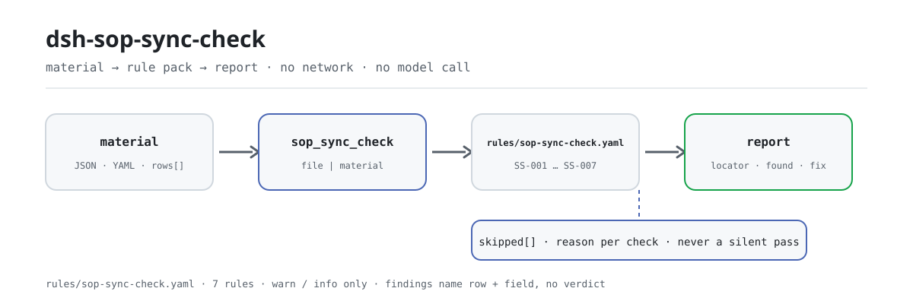

<div align="center">

<picture>
  <source media="(prefers-color-scheme: dark)" srcset="docs/assets/dsh-sop-sync-check-flow-dark.svg">
  
</picture>

# dsh-sop-sync-check

**把作业规程台账与它引用的 PFMEA、控制计划对齐——逐行告诉你哪一行、哪一栏、差什么。**

面向工艺、质量与文件管理的核对工具：交一份作业规程台账，按版本化的规则库做机械比对，输出可逐条指认的差异清单；不改原件，不判合规。

[安装](#三步上手) · [配置](#配置) · [FAQ](#faq) · [简体中文](README.md) · [English](README.en.md) · [Español](README.es.md) · [Português](README.pt.md) · [हिन्दी](README.hi.md)

[](LICENSE)
[](#兼容性)
[](https://www.npmjs.com/package/dsh-sop-sync-check)
[](https://github.com/PerryLink/dsh-sop-sync-check/actions/workflows/ci.yml)
[](#兼容性)

[](https://github.com/PerryLink/dsh-sop-sync-check/stargazers)
[](https://www.npmjs.com/package/dsh-sop-sync-check)
[](https://dshfind.com/plugins/PerryLink/dsh-sop-sync-check?ref=badge)
[](https://securityscorecards.dev/viewer/?uri=github.com/PerryLink/dsh-sop-sync-check)
[](https://dsh.market/)
[](https://gitee.com/perrylink/dsh-sop-sync-check)

```sh
dsh plugin --profile <name> add dsh-sop-sync-check
```

</div>

<sub>社区插件，与 DeepSeek 官方无关。唯一仓库：<https://github.com/PerryLink/dsh-sop-sync-check>（Gitee 为镜像）。</sub>

## 它是什么

`dsh-sop-sync-check` 读取一份作业规程台账——产品表头加每道工序一行——核对它与台账所引 PFMEA、控制计划之间的机械一致性：每道工序是否声明了规程编号、是否引用了 PFMEA 或控制计划、行内引用的版本与台账记录的现行版本是否一致、填了工艺参数的是否填了参数公差、工序号是否重复、表头是否写明产品、修订日期是否可解析且不晚于核对日。它不判断工艺参数设置是否合理、控制计划是否覆盖了全部失效模式、PFMEA 的风险分析是否到位；无法执行的检查会列在 `skipped` 中，而不是静默通过。

给工艺、质量、文件管理的人用，不必懂命令行：你交这项核对用到的原始材料（表格、清单或文书），原件不会被改动；Excel 可先转成 JSON/YAML，对话里也能代转。

```text
材料（JSON / YAML） ──▶ sop_sync_check ──▶ rules/sop-sync-check.yaml ──▶ 报告
                                                                  └─▶ skipped（无法执行的检查 + 原因）
```

## 三步上手

1. **安装**（三选一）：

   ```sh
   # git 通道（最新 main）
   dsh plugin --profile <name> add github:PerryLink/dsh-sop-sync-check
   # npm 通道（已发布版本，当前 0.2.9）
   dsh plugin --profile <name> add dsh-sop-sync-check
   # tarball 通道：本仓库 pnpm pack 后
   dsh plugin --profile <name> add ./dsh-sop-sync-check-<version>.tgz
   ```

   也可以在 WorkBuddy / 扣子搜索「职业文档核对全集」（总包，本检查是其中一项；上架以商城为准）。

2. **最小材料**（JSON 或 YAML 皆可，表头 + 每道工序一行）：

   ```yaml
   productNo: P-2026-001
   productName: 前支架
   rows:
     - { 规程编号: WI-2026-018, 工序号: OP20, 工序名称: 精车外圆,
         工艺参数: 主轴转速 1200 r/min, 参数公差: ±50 r/min,
         PFMEA编号: PFMEA-2026-003 V2, PFMEA现行版本: V2,
         控制计划编号: CP-2026-003 V2, 控制计划现行版本: V2, 修订日期: 2026-03-08 }
   ```

3. **验证已生效**：

   ```sh
   dsh --profile <name> --dump-config | grep 'dsh-sop-sync-check'
   ```

   然后在对话里让模型调用 `sop_sync_check`，把上面的材料（`file` 或 `material`）交给它。不装宿主也能跑本仓样例：

   ```sh
   pnpm install
   pnpm run build
   node samples/quickstart/run.mjs --json
   ```

   输出与 `samples/quickstart/expected/result.json` 一致（`issueCount: 2`、`warn: 2`、`skippedCount: 1`）；只想要一句摘要就去掉 `--json`。终端截图见 [`docs/assets/quickstart.png`](docs/assets/quickstart.png)。

**卸载**：`dsh plugin --profile <name> remove dsh-sop-sync-check`（或从 profile patch 删掉该行）。

## 核心能力

规则即数据：`rules/sop-sync-check.yaml` 声明每一条检查，替换该文件即可切换规则集版本，无需改动 TypeScript。规则库在加载期校验，不被信任；每条差异都给出行号、字段、发现、期望与修法。

| 规则 | 检查 | 严重度 | 依据类型 |
|---|---|---|---|
| `SS-001` | 每道工序声明规程编号 | warn | 原则推导 |
| `SS-002` | 规程引用 PFMEA 或控制计划 | warn | 原则推导 |
| `SS-003` | 引用的版本与文件现行版本一致 | warn | 原则推导 |
| `SS-004` | 填了工艺参数的工序填了参数公差 | warn | 原则推导 |
| `SS-005` | 工序号唯一 | warn | 原则推导 |
| `SS-006` | 表头写明产品 | warn | 原则推导 |
| `SS-007` | 修订日期可解析且不在未来 | warn | 原则推导 |

- **可定位到行与栏**：报告里的 `locator` 给出 `row` 与 `field`，`found` / `expected` / `fix` 分别说明发现了什么、期望是什么、建议怎么改——决定权仍在人。
- **空结果不等于没问题**：任何无法执行的检查都会进入 `skipped` 并写明原因；被停用的规则同样出现在 `skipped` 里，不会静默消失。
- **只做字面比对**：不判断工艺参数设置是否合理、控制计划是否覆盖全部失效模式、PFMEA 分析是否充分，也不作出合规、责任或正确性结论。
- **版本串要带明确提示**：`SS-003` 只把 `V`、`VER`、`REV`、`版本`、`版次` 这类标记后的内容当版本，文件编号末尾的数字不会被误当成版本。

### 工具面

| 入参 | 必填 | 说明 |
|---|---|---|
| `file` | 二选一 | 材料文件路径（JSON 或 YAML） |
| `material` | 二选一 | 内联材料文本（JSON 或 YAML） |
| `rulesFile` | 否 | 覆盖配置中的规则库路径（相对插件包根或绝对路径） |
| `only` | 否 | 只执行这些规则 id；留空执行全部（并叠加配置里的 `onlyRules`） |

### 示例

以下是本插件对自己 `SS-003` 测试夹具的真实输出，不是示意图。规则库不伪造引文，因此每条发现都会同时写明所引条款，以及该条款原文本次未取得。

**工具** `sop_sync_check`

**输入**

```json
{"pfmeaVersion":"V2","rows":[{"PFMEA编号":"PFMEA-2026-003 V1"}]}
```

**输出**

```json
{
  "id": "dsh-sop-sync-check.SS-003.de09b5a6",
  "ruleId": "SS-003",
  "severity": "warn",
  "locator": {
    "row": 1,
    "field": "pfmeaRef"
  },
  "found": "第 1 行引用的版本「1」与文件现行版本「2」不一致",
  "expected": "引用的版本应与该文件的现行版本一致",
  "fix": "核对是否还停在上一版；本条只比对版本串，不判断该引用应当指向哪一版"
}
```

*Observed from `dsh-sop-sync-check/tests/fixtures/SS-003/SS-003-unsafe.json`*

逐条行为如下：

| 你会问 | 它怎么答 |
|---|---|
| 某道工序行的规程编号栏是空的。 | `SS-001` 会报出该行：本条要求凡带规程编号栏的行都必须填写，且只核对是否填写，不判断这份规程是不是该工序该用的那一份。材料里根本没有这一栏时，本条报告「不适用」，而不是静默通过。 |
| 这份作业指导书对应哪份 PFMEA、哪份控制计划，没人写。 | `SS-002` 要求每行的 PFMEA编号与控制计划编号至少填写一项。它只核对「至少引用了一个」，不判断引用得是否恰当，也不核对引用的是不是现行版本——那是 `SS-003` 的事。 |
| 规程里引用的还是上一版 PFMEA，能查出来吗？ | 能。`SS-003` 从单独的版本栏，或从引用文本尾部提取版本串（如 `PFMEA-2026-003 V2`），版本串需要 `V`、`VER`、`REV`、`版本`、`版次` 这类明确提示，因此文件编号末尾的数字不会被误当成版本；版本串与文件现行版本不一致的引用会逐行报出。它只比对版本串，不判断该引用应当指向哪一版。两处都取不到可比版本串时，本条报告「无法执行」。 |
| 工艺参数栏填了，参数公差栏空着。 | `SS-004` 会报出该行，但只在参数栏已填写时才要求公差栏，因此本工序确实无需参数的行不会被报出。它只核对公差栏是否填写，不判断该参数与公差设置是否合理。 |
| 同一个工序号在两行里都出现了。 | `SS-005` 会报出重复的工序号，并指出它第一次出现在哪一行；比较时忽略空白字符。重复通常意味着重复登记或工序号抄错，哪一行是对的仍由人工确认。材料里没有工序号栏时，本条报告「不适用」，而不是通过。 |
| 修订日期写成 `2026/3/8`，另有一行写的是下个月。 | `SS-007` 会报出无法解析为日期的修订日期，也会报出晚于核对日的日期。它只核对日期是否可解析、是否不晚于核对日，不判断修订是否及时。 |

## 配置

全部可调参数都在 `src/config.ts` 的 Schemastery schema 中，只改 `cordis.yml` 即可生效，无需改代码；逐条阈值在 `rules/` 下的规则库文件里。

| 键 | 类型 | 默认值 | 说明 |
|---|---|---|---|
| `rulesFile` | string | `rules/sop-sync-check.yaml` | 规则库文件路径，相对插件包根目录 |
| `disabledRules` | string[] | `[]` | 要停用的规则 id 列表；每条都会出现在 `skipped` 中 |
| `onlyRules` | string[] | `[]` | 只执行这些规则 id；留空表示执行全部规则 |
| `skipNotes` | string | `""` | 附加到每条 `skipped` 说明后的备注 |
| `timeoutMs` | number | `120000` | 工具协作式超时预算（毫秒） |

<details>
<summary>规则级参数（SS-003 / SS-004）</summary>

- `SS-003` 的 `referenceField` / `actualVersionField` / `sameVersionField` 决定「引用版本」与「文件现行版本」分别从哪一列读取。`actualVersionField` 可以是列表，取第一个非空候选；裸版本（`V2`）或带版本的引用（`PFMEA-2026-003 V2`）都能识别。若台账把引用版本单列一栏，把它填进 `sameVersionField`。
- `SS-004` 的 `conditionField` / `requiredFields` 决定哪个栏目触发要求、以及它需要补齐哪些栏目。

这些字段写在规则库文件里，与 `config.ts` 的五个运行参数分开：前者改规则，后者改部署行为。

</details>

profile patch 覆盖示例：

```yaml
- insert:
    - id: dsh-sop-sync-check
      name: dsh-sop-sync-check
      config:
        onlyRules: [SS-001, SS-003, SS-005]
        skipNotes: 本机构实施细则 v3
        timeoutMs: 60000
```

## FAQ

<details>
<summary>材料会被发到哪里？数据存哪？</summary>

不联网、不调用模型、不写文件。插件只读你通过 `file` 传入的文件或 `material` 传入的内联文本，在进程内完成解析与比对；报告只回到当前会话。仓库里没有网络代码，也没有凭据配置。

</details>

<details>
<summary>一条规则没跑，会不会被当成「没问题」？</summary>

不会。无法执行的检查（缺列、取不到可比版本串、规则被停用等）逐项进入 `skipped`，并写明规则 id 与原因；`config.skipNotes` 还能给每条 `skipped` 追加一句本机构的备注。空的问题列表只代表「这次能跑的检查都没报出差异」，不代表「没有问题」。

</details>

<details>
<summary>它会替我判定合规或责任吗？</summary>

不会。它只列出材料内部能逐条指认的字面差异，供人工复核；报告自带免责声明，不作出合规、责任或正确性结论。工艺参数是否合理、控制计划是否覆盖全部失效模式、PFMEA 分析是否到位，都属于工艺与质量工程师的判断。

</details>

<details>
<summary>会和其他插件抢工具名或事件吗？</summary>

只注册 `sop_sync_check` 这一个工具（`inject: ['tools']`），不注册命令、客户端 slot 或 HTTP 路由，也不提供任何服务键；注册本身是 Cordis effect，卸载或热重载即撤销。

</details>

<details>
<summary>性能开销多大？</summary>

纯字符串与表格运算，无网络、无模型调用；默认协作式超时预算为 `timeoutMs: 120000`，超时由工具执行框架接管。整份台账一次调用完成，批量核对多份材料时建议用 `ptc` 工具模式，schema 成本只付一次。

</details>

## 标准依据与引文边界

本规则库不引用任何公开标准：核查未取得 IATF 16949 与汽车行业核心工具手册的逐字条文，因此每条规则的 `basis` 都如实写明这一点，`kind` 一律为 derived-from-principle，严重度封顶 `warn`。它依据的是台账自己写的编号与版本——规程编号栏里的编号、PFMEA／控制计划引用旁记录的版本、参数旁的公差、修订日期——以及它们之间的相互比对。

| 文件 | 文号 | 引用它的规则 |
|---|---|---|
| IATF 16949／汽车行业核心工具手册 | 现行版本与条号本次未核实 | SS-001, SS-002, SS-003, SS-004, SS-005, SS-006, SS-007 |

**边界：** 本插件核对一份 **作业规程台账** 与其 **PFMEA** 及 **控制计划** 的机械一致性——是否记录编号，是否引用 PFMEA 与控制计划，规程所引版本是否与文档的当前版本一致，参数是否带有公差，工序编号是否唯一，台账是否写明其产品，以及修订日期是否可解析。它**不**判定工艺参数是否正确、控制计划是否覆盖每一个失效模式，或 PFMEA 分析是否充分。**这些属于工艺与质量工程师的判断。**

> ### ⚠️ 在相信报告中的引文之前，请先读这一节
>
> **本插件规则库中的每一个 `excerpt` 都明文写着：条款原文本次未取得。** 该制度见于 IATF 16949 与汽车行业核心工具手册（APQP、PFMEA、控制计划）。核验环节无法从这些文件中取得逐字条款原文，因此规则库没有去转述一段引文，而是在 `excerpt` 字段本身写明这一缺口，并把诚实的推理写进 `note`。因此每条规则都是 `warn` 或 `info`，且有测试断言：没有任何规则声称拥有它实际没有的引文。**待取得原文后，必须做两件事：把每个 `excerpt` 换成真实条款，并把 `kind` 提到 `direct`。**
>
> `SS-003` 是最能体现价值的一条：**作业规程仍在引用上一版 PFMEA**，是这三份文件彼此脱节最常见、也最危险的方式。它要么从专门的栏读取版本，要么从引用文字末尾的版本标记（`PFMEA-2026-003 V2`）读取，并且需要一个明确的提示词——`V`、`VER`、`REV`、`版本`、`版次`——这样*文档编号*末尾的数字就永远不会被误认为版本号。两种来源都不可用时，它把自己记入 `skipped`。

## 材料格式

支持 JSON 与 YAML。字段在读取层是可选的，由检查引擎校验，因此部分导出的材料会产生「缺项」类差异，而不是让程序崩溃。

```yaml
productNo: P-2026-001
productName: 前支架
rows:
  - { 规程编号: WI-2026-018, 工序号: OP20, 工序名称: 精车外圆,
      工艺参数: 主轴转速 1200 r/min, 参数公差: ±50 r/min,
      PFMEA编号: PFMEA-2026-003 V2, PFMEA现行版本: V2,
      控制计划编号: CP-2026-003 V2, 控制计划现行版本: V2, 修订日期: 2026-03-08 }
```

列名匹配不区分大小写，并忽略空格、下划线与连字符；报告沿用材料里自己的列名，因此每条发现都指向你实际写的那一栏。表头可写 `productNo` / `产品编号` / `零件号`、`productName` / `产品名称`，以及 PFMEA／控制计划的现行版本。日期可写成 `2026-03-08` 或 `2026-03-08 09:30`。

## 规则库来源

规则数据与代码分离，每条规则都带文件名、文号、按原文自身编号体系的条款号、逐字摘录与来源地址。规则库文件头把引文缺口写全，每条规则的 `note` 再复述对该条重要的那部分。加载期强制：摘录必须是真实引文且不少于八个字符；依据仅为原则性条款（`kind: derived-from-principle`，严重级上限 `warn`）或本机构配置（`kind: institutional-configuration`，上限 `info`）的检查不得标为 `error`。这道加载期校验分不清「引文」与「描述」，因此本规则库依赖文件头、每条规则的 `note`，以及一个断言每个 `excerpt` 都承认缺口的测试；夸大依据的规则库会在加载期失败，而不会产出一份看起来很有底气的报告。

核验中确认的边界与「刻意没有作出的结论」见随包的 `rules/evidence/` 目录。

## 兼容性

| 项目 | 状态 |
|---|---|
| Harness | 对等版本范围 `>=0.1.2-rc.1 <0.2.0 \|\| >=0.2.0-0 <0.3.0` —— 已实测同时接受 `0.2.0-rc.2` 与 `0.2.1-rc.2`。已声明 `engines.dsh`：`>=0.2.1-0 <0.3.0`，0.2.1 起由宿主单独裁决 |
| Node | `^22.19.0 \|\| >=24.0.0` |
| 平台 | 全平台（纯 ESM；无原生代码、无联网、不调用模型） |
| 工具模式 | `native` / `ptc` 均可；批量校验整个目录时建议 `ptc`，schema 成本只付一次 |

## 排错

- **插件装上了但工具不出现**：确认 `main` 指向 `lib/index.mjs` 且 `pnpm run build` 已生成该文件；`main` 写错会让加载器静默跳过该条目。
- **`dsh plugin add` 报版本不兼容**：peer 范围覆盖 `0.1.x` 与 `0.2.x`；若运行时在其之外，可显式豁免：`dsh plugin --profile <name> allow-version dsh-sop-sync-check@0.2.9 --dsh-version <runtime> --accept-risk`。
- **某条规则没有执行**：查看 `skipped` 数组，其中写明了规则 id 与原因。
- **`SS-003` 报告自己进了 `skipped`**：引用版本与文件现行版本都取不到。给台账补一列 `PFMEA现行版本`，或把版本写进引用文本尾部（`V2`）。
- **`SS-003` 明明版本不同却没报**：检查现行版本列的解析顺序——`actualVersionField` 取第一个非空候选，靠前的一个过期列会遮住后面的列。
- **`SS-003` 对没有版本的引用也报**：这正是检查本身——一条不说明自己在哪一版的引用，无法比对。
- **`SS-004` 对本不需要参数的工序报缺失公差**：要么参数确实有、只是公差没填，要么本工序没有参数、参数栏应留空。
- **`check` 报 `manifest-peers` 失败**：静态检查器比对的是一份早于 0.2 世代的硬编码 peer 范围；安装期的 peer 校验以运行时为准。这是 `dsh-plugin-dev` 的已知上游问题。
- **时间看起来偏移**：全部计算都是对输入字符串做墙上时钟运算，不做时区换算。

## 生态与质量

- [Gitee 镜像](https://gitee.com/perrylink/dsh-sop-sync-check)（同步镜像，以 GitHub 为准）
- [dshfind 插件页](https://dshfind.com/plugins/PerryLink/dsh-sop-sync-check)（安装量与排名）
- [OpenSSF Scorecard 报告](https://securityscorecards.dev/viewer/?uri=github.com/PerryLink/dsh-sop-sync-check)（由 [.github/workflows/scorecard.yml](.github/workflows/scorecard.yml) 驱动）
- [DSH Market](https://dsh.market/)（已上架）
- [按材料选核查器](https://perrylink.github.io/zh/checkers/choose/)（家族索引：62 个核查器 + 通用插件）

## 开发

```sh
pnpm install
pnpm run typecheck   # tsc --noEmit
pnpm test            # vitest，共享表格插件测试套件 + 成对夹具
pnpm run build       # tsdown -> lib/index.mjs + lib/index.d.mts
node ../scripts/sync-shared.mjs dsh-sop-sync-check   # 刷新 src/shared
pnpm run check:readmes                               # 五语 README 一致性
```

第 5 项把 `../_shared` 的共享件同步进 `src/shared/`；每次改动共享件后都要重跑。

插件是**数据驱动**的：`src/model.ts` 声明表格形状与列别名，`src/shared/` 提供读取器与检查引擎，规则库声明每一条检查。README 配图由 [`scripts/gen-readme-assets.py`](scripts/gen-readme-assets.py) 程序化生成（Python + Pillow），可重复执行。

Topics：`dsh`, `dsh-plugin`, `deepseek-harness`, `deepseek`, `cordis`, `sop`, `sync`

## 家族与致谢

本项目是 [PerryLink](https://github.com/PerryLink) 维护的 DeepSeek Harness 插件家族成员（全部 Apache-2.0）。如果这个插件帮到了你，**给个 star**——它不解锁任何功能，但会让下一个人更容易找到它。

- [@PerryLink](https://github.com/PerryLink) —— 创建者与维护者：规则库设计、表格读取器与检查引擎、`sop_sync_check` 工具与五语文档。

<details>
<summary>展开全部插件</summary>

| 插件 | 状态 |
|---|---|
| **[dsh-aqua-input-check](https://github.com/PerryLink/dsh-aqua-input-check)** |  |
| **[dsh-archive-check](https://github.com/PerryLink/dsh-archive-check)** |  |
| **[dsh-auto-review](https://github.com/PerryLink/dsh-auto-review)** |  |
| **[dsh-autotier](https://github.com/PerryLink/dsh-autotier)** | 🧊 已冻结 — 见仓库 README |
| **[dsh-bid-ca-precheck](https://github.com/PerryLink/dsh-bid-ca-precheck)** |  |
| **[dsh-bid-qual-check](https://github.com/PerryLink/dsh-bid-qual-check)** |  |
| **[dsh-cert-mcp](https://github.com/PerryLink/dsh-cert-mcp)** | 🧊 已冻结 — 见仓库 README |
| **[dsh-checkpoint-rewind](https://github.com/PerryLink/dsh-checkpoint-rewind)** |  |
| **[dsh-click](https://github.com/PerryLink/dsh-click)** |  |
| **[dsh-composer-history](https://github.com/PerryLink/dsh-composer-history)** |  |
| **[dsh-contract-stance](https://github.com/PerryLink/dsh-contract-stance)** |  |
| **[dsh-customs-doc-check](https://github.com/PerryLink/dsh-customs-doc-check)** |  |
| **[dsh-data-quality](https://github.com/PerryLink/dsh-data-quality)** |  |
| **[dsh-demurrage-ledger](https://github.com/PerryLink/dsh-demurrage-ledger)** |  |
| **[dsh-doublecheck](https://github.com/PerryLink/dsh-doublecheck)** |  |
| **[dsh-drill-script-check](https://github.com/PerryLink/dsh-drill-script-check)** |  |
| **[dsh-eia-guide-check](https://github.com/PerryLink/dsh-eia-guide-check)** |  |
| **[dsh-emergency-plan](https://github.com/PerryLink/dsh-emergency-plan)** |  |
| **[dsh-essay-rubric-check](https://github.com/PerryLink/dsh-essay-rubric-check)** |  |
| **[dsh-evidence-check](https://github.com/PerryLink/dsh-evidence-check)** |  |
| **[dsh-export-ctl-check](https://github.com/PerryLink/dsh-export-ctl-check)** |  |
| **[dsh-fast](https://github.com/PerryLink/dsh-fast)** |  |
| **[dsh-fmea-table-check](https://github.com/PerryLink/dsh-fmea-table-check)** |  |
| **[dsh-forecast-penalty](https://github.com/PerryLink/dsh-forecast-penalty)** |  |
| **[dsh-fund-research](https://github.com/PerryLink/dsh-fund-research)** |  |
| **[dsh-github](https://github.com/PerryLink/dsh-github)** |  |
| **[dsh-gongwen-flow-check](https://github.com/PerryLink/dsh-gongwen-flow-check)** |  |
| **[dsh-gongwen-word-check](https://github.com/PerryLink/dsh-gongwen-word-check)** |  |
| **[dsh-guard-plan-qc](https://github.com/PerryLink/dsh-guard-plan-qc)** |  |
| **[dsh-hazchem-check](https://github.com/PerryLink/dsh-hazchem-check)** |  |
| **[dsh-hazplan-check](https://github.com/PerryLink/dsh-hazplan-check)** |  |
| **[dsh-hidden-risk-map](https://github.com/PerryLink/dsh-hidden-risk-map)** |  |
| **[dsh-hs-classify](https://github.com/PerryLink/dsh-hs-classify)** |  |
| **[dsh-icd-rule-check](https://github.com/PerryLink/dsh-icd-rule-check)** |  |
| **[dsh-industry-research](https://github.com/PerryLink/dsh-industry-research)** |  |
| **[dsh-lawcite-adapter](https://github.com/PerryLink/dsh-lawcite-adapter)** |  |
| **[dsh-laya](https://github.com/PerryLink/dsh-laya)** |  |
| **[dsh-lc-doc-check](https://github.com/PerryLink/dsh-lc-doc-check)** |  |
| **[dsh-learning-gap-check](https://github.com/PerryLink/dsh-learning-gap-check)** |  |
| **[dsh-library](https://github.com/PerryLink/dsh-library)** |  |
| **[dsh-local-ai](https://github.com/PerryLink/dsh-local-ai)** |  |
| **[dsh-lsp-actions](https://github.com/PerryLink/dsh-lsp-actions)** |  |
| **[dsh-mask](https://github.com/PerryLink/dsh-mask)** |  |
| **[dsh-mcp-panel](https://github.com/PerryLink/dsh-mcp-panel)** |  |
| **[dsh-medrec-qc](https://github.com/PerryLink/dsh-medrec-qc)** |  |
| **[dsh-memento](https://github.com/PerryLink/dsh-memento)** |  |
| **[dsh-nsfc-form-check](https://github.com/PerryLink/dsh-nsfc-form-check)** |  |
| **[dsh-nurse-record-check](https://github.com/PerryLink/dsh-nurse-record-check)** |  |
| **[dsh-observe](https://github.com/PerryLink/dsh-observe)** |  |
| **[dsh-origin-rvc-check](https://github.com/PerryLink/dsh-origin-rvc-check)** |  |
| **[dsh-ota-review-check](https://github.com/PerryLink/dsh-ota-review-check)** |  |
| **[dsh-output-styles](https://github.com/PerryLink/dsh-output-styles)** |  |
| **[dsh-paper-doc-adapter](https://github.com/PerryLink/dsh-paper-doc-adapter)** |  |
| **[dsh-permission-rules](https://github.com/PerryLink/dsh-permission-rules)** |  |
| **[dsh-permit-report-check](https://github.com/PerryLink/dsh-permit-report-check)** |  |
| **[dsh-pipeline-check](https://github.com/PerryLink/dsh-pipeline-check)** |  |
| **[dsh-pleading-draft](https://github.com/PerryLink/dsh-pleading-draft)** |  |
| **[dsh-plugin-doctor](https://github.com/PerryLink/dsh-plugin-doctor)** | 🚫 已退役（仓库已归档） |
| **[dsh-plugin-guide](https://github.com/PerryLink/dsh-plugin-guide)** |  |
| **[dsh-plugin-kit](https://github.com/PerryLink/dsh-plugin-kit)** | 🚫 已退役（仓库已归档） |
| **[dsh-plugin-upgrade](https://github.com/PerryLink/dsh-plugin-upgrade)** | 🚫 已退役（仓库已归档） |
| **[dsh-policy-brief-draft](https://github.com/PerryLink/dsh-policy-brief-draft)** |  |
| **[dsh-power-loss-split](https://github.com/PerryLink/dsh-power-loss-split)** |  |
| **[dsh-power-ticket-check](https://github.com/PerryLink/dsh-power-ticket-check)** |  |
| **[dsh-ppap-check](https://github.com/PerryLink/dsh-ppap-check)** |  |
| **[dsh-protest-deadline](https://github.com/PerryLink/dsh-protest-deadline)** |  |
| **[dsh-railway-window](https://github.com/PerryLink/dsh-railway-window)** |  |
| **[dsh-repair-order-qc](https://github.com/PerryLink/dsh-repair-order-qc)** |  |
| **[dsh-research-report](https://github.com/PerryLink/dsh-research-report)** |  |
| **[dsh-review-reply-check](https://github.com/PerryLink/dsh-review-reply-check)** |  |
| **[dsh-rulefile-check](https://github.com/PerryLink/dsh-rulefile-check)** |  |
| **[dsh-safety-brief-check](https://github.com/PerryLink/dsh-safety-brief-check)** |  |
| **[dsh-score](https://github.com/PerryLink/dsh-score)** |  |
| **[dsh-session-sync](https://github.com/PerryLink/dsh-session-sync)** |  |
| **[dsh-site-log-check](https://github.com/PerryLink/dsh-site-log-check)** |  |
| **[dsh-skill-pack-security](https://github.com/PerryLink/dsh-skill-pack-security)** |  |
| **[dsh-soe-decision-check](https://github.com/PerryLink/dsh-soe-decision-check)** |  |
| **[dsh-soilwater-check](https://github.com/PerryLink/dsh-soilwater-check)** |  |
| **[dsh-sop-sync-check](https://github.com/PerryLink/dsh-sop-sync-check)** |  |
| **[dsh-spc-gbt-adapter](https://github.com/PerryLink/dsh-spc-gbt-adapter)** |  |
| **[dsh-talk](https://github.com/PerryLink/dsh-talk)** |  |
| **[dsh-tender-extract](https://github.com/PerryLink/dsh-tender-extract)** |  |
| **[dsh-tender-matrix](https://github.com/PerryLink/dsh-tender-matrix)** |  |
| **[dsh-test-drive](https://github.com/PerryLink/dsh-test-drive)** |  |
| **[dsh-ticktick](https://github.com/PerryLink/dsh-ticktick)** | 🚫 已退役（仓库已归档） |
| **[dsh-translate](https://github.com/PerryLink/dsh-translate)** |  |
| **[dsh-warranty-calc](https://github.com/PerryLink/dsh-warranty-calc)** |  |
| **[dsh-budget](https://github.com/PerryLink/dsh-budget)** | 🧊 已冻结 — 见仓库 README |
| **[dsh-claude-move](https://github.com/PerryLink/dsh-claude-move)** | 🧊 已冻结 — 见仓库 README |
| **[dsh-defend](https://github.com/PerryLink/dsh-defend)** | 🧊 已冻结 — 见仓库 README |
| **[dsh-draw](https://github.com/PerryLink/dsh-draw)** | 🧊 已冻结 — 见仓库 README |
| **[dsh-reach](https://github.com/PerryLink/dsh-reach)** | 🧊 已冻结 — 见仓库 README |
| **[dsh-background-agents](https://github.com/PerryLink/dsh-background-agents)** | 🚫 已退役（仓库已归档） |
| **[dsh-session-pin](https://github.com/PerryLink/dsh-session-pin)** | 🚫 已退役（仓库已归档） |
| **[dsh-team-rooms](https://github.com/PerryLink/dsh-team-rooms)** | 🚫 已退役（仓库已归档） |
</details>

## License

[LICENSE](LICENSE)（Apache License 2.0）© 2026 dsh-sop-sync-check contributors

<p align="center"><sub>Apache-2.0 · 社区插件，与 DeepSeek 无关。</sub></p>
