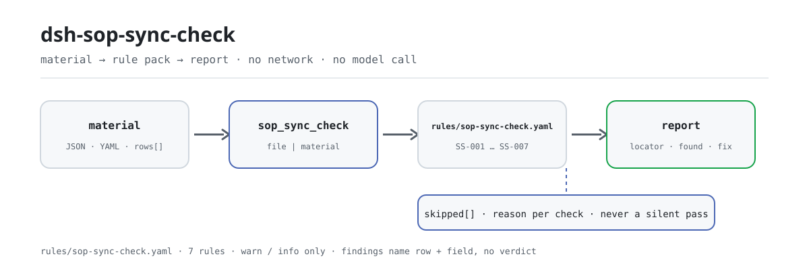

<div align="center">

<picture>
  <source media="(prefers-color-scheme: dark)" srcset="docs/assets/dsh-sop-sync-check-flow-dark.svg">
  
</picture>

# dsh-sop-sync-check

**Alinhe o registro de instruções de trabalho com o PFMEA e o plano de controlo que ele cita — e saiba qual linha, qual coluna e o que difere.**

Uma ferramenta de conciliação para processo, qualidade e controlo documental: entregue um registro de instruções de trabalho e ela o compara mecanicamente com um pacote de regras versionado, devolvendo uma lista de diferenças apontáveis linha a linha. Não altera o original nem decide conformidade.

[Instalação](#instalação-em-três-passos) · [Configuração](#configuração) · [FAQ](#faq) · [简体中文](README.md) · [English](README.en.md) · [Español](README.es.md) · [Português](README.pt.md) · [हिन्दी](README.hi.md)

[](LICENSE)
[](#compatibilidade)
[](https://www.npmjs.com/package/dsh-sop-sync-check)
[](https://github.com/PerryLink/dsh-sop-sync-check/actions/workflows/ci.yml)
[](#compatibilidade)

[](https://github.com/PerryLink/dsh-sop-sync-check/stargazers)
[](https://www.npmjs.com/package/dsh-sop-sync-check)
[](https://dshfind.com/plugins/PerryLink/dsh-sop-sync-check?ref=badge)
[](https://securityscorecards.dev/viewer/?uri=github.com/PerryLink/dsh-sop-sync-check)
[](https://dsh.market/)
[](https://gitee.com/perrylink/dsh-sop-sync-check)

```sh
dsh plugin --profile <name> add dsh-sop-sync-check
```

</div>

<sub>Plugin da comunidade, sem relação com a DeepSeek. Repositório canônico: <https://github.com/PerryLink/dsh-sop-sync-check> (o Gitee é um espelho).</sub>

## O que é

`dsh-sop-sync-check` lê um registro de instruções de trabalho —o cabeçalho de produto mais uma linha por operação— e verifica a coerência mecânica desse registro com o PFMEA e o plano de controlo que cita: se cada linha de operação traz número de procedimento, se o PFMEA ou o plano de controlo é citado, se a revisão citada na linha coincide com a revisão que o registro indica como vigente, se um parâmetro declarado traz tolerância, se nenhum número de operação se repete, se o cabeçalho identifica o produto e se a data de revisão é analisável e não é posterior à data de verificação. Não julga se os parâmetros de processo estão corretos, se o plano de controlo cobre todos os modos de falha nem se a análise PFMEA é adequada; uma verificação que não pode correr é listada em `skipped` em vez de passar em silêncio.

Foi feito para quem trabalha com processo, qualidade e controlo documental e não deveria precisar de linha de comando: entregue o material de origem da verificação —uma tabela, um registro ou um documento— e o original nunca é alterado. O Excel pode ser convertido antes para JSON/YAML, no chat se a plataforma permitir.

```text
material (JSON / YAML) ──▶ sop_sync_check ──▶ rules/sop-sync-check.yaml ──▶ relatório
                                                                    └─▶ skipped (verificação não executável + motivo)
```

## Instalação em três passos

1. **Instalar** (escolha um canal):

   ```sh
   # canal git (main mais recente)
   dsh plugin --profile <name> add github:PerryLink/dsh-sop-sync-check
   # canal npm (versão publicada; atualmente 0.2.9)
   dsh plugin --profile <name> add dsh-sop-sync-check
   # canal tarball: após pnpm pack neste repositório
   dsh plugin --profile <name> add ./dsh-sop-sync-check-<version>.tgz
   ```

   Também faz parte do «Professional Document Check Suite» no WorkBuddy / Coze (o conjunto completo; esta verificação é uma das partes; disponibilidade conforme cada mercado).

2. **Material mínimo** (JSON ou YAML; um cabeçalho e uma linha por operação):

   ```yaml
   productNo: P-2026-001
   productName: 前支架
   rows:
     - { 规程编号: WI-2026-018, 工序号: OP20, 工序名称: 精车外圆,
         工艺参数: 主轴转速 1200 r/min, 参数公差: ±50 r/min,
         PFMEA编号: PFMEA-2026-003 V2, PFMEA现行版本: V2,
         控制计划编号: CP-2026-003 V2, 控制计划现行版本: V2, 修订日期: 2026-03-08 }
   ```

3. **Verificar que está ativo**:

   ```sh
   dsh --profile <name> --dump-config | grep 'dsh-sop-sync-check'
   ```

   Depois peça ao modelo que chame `sop_sync_check`, passando o material acima como `file` ou `material`. Também pode correr o exemplo do repositório sem host:

   ```sh
   pnpm install
   pnpm run build
   node samples/quickstart/run.mjs --json
   ```

   A saída coincide com `samples/quickstart/expected/result.json` (`issueCount: 2`, `warn: 2`, `skippedCount: 1`); remova `--json` para um resumo de uma linha. Captura de terminal: [`docs/assets/quickstart.png`](docs/assets/quickstart.png).

**Desinstalar**: `dsh plugin --profile <name> remove dsh-sop-sync-check` (ou remova a linha do patch do perfil).

## Capacidades principais

O pacote de regras é dado: `rules/sop-sync-check.yaml` declara cada verificação, portanto substituir esse arquivo troca a versão do conjunto de regras sem tocar em TypeScript. O pacote é validado ao carregar, não é confiado; cada achado informa linha e coluna, o encontrado, o esperado e uma sugestão de correção.

| Regra | Verificação | Severidade | Tipo de base |
|---|---|---|---|
| `SS-001` | cada operação declara número de procedimento | warn | princípio |
| `SS-002` | o procedimento cita o seu PFMEA ou plano de controlo | warn | princípio |
| `SS-003` | a revisão citada coincide com a revisão vigente do documento | warn | princípio |
| `SS-004` | um parâmetro declarado traz tolerância | warn | princípio |
| `SS-005` | os números de operação são únicos | warn | princípio |
| `SS-006` | o registro nomeia o seu produto | warn | princípio |
| `SS-007` | a data de revisão é analisável e não está no futuro | warn | princípio |

- **Localizável por linha e coluna.** O `locator` do relatório traz `row` e `field`; `found` / `expected` / `fix` dizem o que se viu, o que se esperava e como corrigir — a decisão continua humana.
- **Resultado vazio não é atestado.** Toda verificação que não pôde correr entra em `skipped` com o motivo, e uma regra desativada também aparece lá em vez de desaparecer em silêncio.
- **Apenas comparação literal.** Não julga se os parâmetros são razoáveis, se o plano de controlo cobre todos os modos de falha ou se a análise PFMEA é suficiente, e não emite veredictos de conformidade, responsabilidade ou correção.
- **Cadeias de versão precisam de sinal explícito.** `SS-003` só trata como revisão o que segue `V`, `VER`, `REV` ou uma palavra de versão/revisão, para que os dígitos finais de um número de documento nunca sejam tomados por uma revisão.

### Superfície da ferramenta

| Argumento | Obrigatório | Significado |
|---|---|---|
| `file` | um dos dois | caminho do arquivo de material (JSON ou YAML) |
| `material` | um dos dois | texto de material em linha (JSON ou YAML) |
| `rulesFile` | não | substitui o caminho configurado do pacote de regras (relativo ao pacote ou absoluto) |
| `only` | não | executa apenas essas regras; vazio executa todas (combinado com `onlyRules` da configuração) |

### Exemplos

A saída abaixo é a saída real deste plugin sobre o seu próprio fixture `SS-003`, não uma ilustração. O pacote de regras não inventa citações, por isso cada achado nomeia a cláusula aplicada e avisa que o seu texto não foi obtido desta vez.

**Ferramenta** `sop_sync_check`

**Entrada**

```json
{"pfmeaVersion":"V2","rows":[{"PFMEA编号":"PFMEA-2026-003 V1"}]}
```

**Saída**

```json
{
  "id": "dsh-sop-sync-check.SS-003.de09b5a6",
  "ruleId": "SS-003",
  "severity": "warn",
  "locator": {
    "row": 1,
    "field": "pfmeaRef"
  },
  "found": "第 1 行引用的版本「1」与文件现行版本「2」不一致",
  "expected": "引用的版本应与该文件的现行版本一致",
  "fix": "核对是否还停在上一版；本条只比对版本串，不判断该引用应当指向哪一版"
}
```

*Observed from `dsh-sop-sync-check/tests/fixtures/SS-003/SS-003-unsafe.json`*

Regra a regra:

| Você pergunta | O que ele responde |
|---|---|
| Uma linha de operação deixa vazia a coluna do número de procedimento. | `SS-001` reporta essa linha: a regra exige que a coluna do número de procedimento esteja preenchida em toda a linha que a traga, e verifica apenas a presença, não se o procedimento é o certo para essa operação. Se o material não tiver essa coluna, a regra reporta que não se aplica em vez de passar em silêncio. |
| Ninguém anotou a que PFMEA ou a que plano de controlo pertence esta instrução de trabalho. | `SS-002` exige que se preencha em cada linha pelo menos uma das colunas de referência ao PFMEA e ao plano de controlo. Verifica apenas que se cita pelo menos uma, não se a referência é adequada nem se a revisão indicada é a vigente; essa comparação é a `SS-003`. |
| O procedimento continua a citar a revisão anterior do PFMEA. Isso é detetado? | Sim. `SS-003` lê a revisão de uma coluna própria ou de um marcador de versão no fim do texto da referência (`PFMEA-2026-003 V2`); o marcador precisa de uma pista explícita como `V`, `VER`, `REV` ou uma palavra de versão/revisão, para que os dígitos finais de um número de documento nunca sejam tomados por uma revisão. Reporta a referência cujo texto de versão difere da revisão vigente do documento, e compara apenas cadeias de versão: não decide para que revisão a referência deveria apontar. Quando não há coluna de revisão nem cadeia legível, reporta-se a si mesma em `skipped`. |
| A coluna de parâmetros está preenchida, mas a de tolerância está vazia. | `SS-004` reporta essa linha, mas só quando a coluna de parâmetros está preenchida, pelo que uma operação que realmente não leva parâmetro não é assinalada. Verifica que a coluna de tolerância está preenchida, não que o parâmetro e a sua tolerância sejam razoáveis. |
| O mesmo número de operação aparece em duas linhas. | `SS-005` reporta o número de operação repetido e nomeia a primeira linha em que apareceu; na comparação os espaços são ignorados. A repetição costuma significar registro duplicado ou número mal copiado: qual das linhas está certa continua a ser decisão humana. Sem coluna de número de operação, a regra reporta que não se aplica em vez de passar. |
| Uma data de revisão está como `2026/3/8` e outra linha traz a do mês que vem. | `SS-007` reporta uma data de revisão que não consegue analisar e também uma data posterior à data de verificação. Verifica que a data é analisável e não cai depois da data de verificação; não julga se a revisão foi feita a tempo. |

## Configuração

Todos os parâmetros ajustáveis ficam no esquema Schemastery de `src/config.ts`, portanto mudam pelo `cordis.yml` sem editar código; os limites por regra ficam no pacote de regras sob `rules/`.

| Chave | Tipo | Padrão | Descrição |
|---|---|---|---|
| `rulesFile` | string | `rules/sop-sync-check.yaml` | Caminho do pacote de regras, relativo à raiz do pacote |
| `disabledRules` | string[] | `[]` | Ids de regras a desativar; cada uma aparece em `skipped` |
| `onlyRules` | string[] | `[]` | Executar apenas estas regras; vazio executa todas |
| `skipNotes` | string | `""` | Nota acrescentada a cada motivo de `skipped` |
| `timeoutMs` | number | `120000` | Orçamento de tempo limite cooperativo da ferramenta |

<details>
<summary>Parâmetros por regra (SS-003 / SS-004)</summary>

- `SS-003` usa `referenceField` / `actualVersionField` / `sameVersionField` para decidir de que coluna vêm a revisão citada e a revisão vigente do documento. `actualVersionField` pode ser uma lista; o primeiro candidato não vazio vence, e funcionam tanto uma versão nua (`V2`) como uma referência que a traga (`PFMEA-2026-003 V2`). Se o registro guarda a revisão citada numa coluna própria, indique-a em `sameVersionField`.
- `SS-004` usa `conditionField` / `requiredFields` para decidir que coluna aciona o requisito e o que ele precisa.

Estes campos vivem no arquivo do pacote de regras e são independentes das cinco chaves de execução de `config.ts`: uns mudam as regras, as outras o comportamento da implantação.

</details>

Exemplo de substituição no patch do perfil:

```yaml
- insert:
    - id: dsh-sop-sync-check
      name: dsh-sop-sync-check
      config:
        onlyRules: [SS-001, SS-003, SS-005]
        skipNotes: regras internas de implantação v3
        timeoutMs: 60000
```

## FAQ

<details>
<summary>Para onde vai o material? Algo fica guardado?</summary>

Para nenhum lugar: sem rede, sem chamada ao modelo e sem escrita de arquivos. O plugin lê apenas o arquivo que você passa como `file` ou o texto em linha que passa como `material`, analisa e compara no próprio processo, e devolve o relatório à sessão atual. O repositório não contém código de rede nem configuração de credenciais.

</details>

<details>
<summary>Se uma regra não correu, isso pode ser lido como «nada de errado»?</summary>

Não. Toda verificação que não pôde correr —coluna ausente, nenhuma cadeia de versão comparável, regra desativada— é listada em `skipped` com o id e o motivo, e `config.skipNotes` pode acrescentar uma nota institucional a cada entrada. Uma lista de problemas vazia significa apenas que as verificações executáveis não acharam diferenças; não significa que o material esteja limpo.

</details>

<details>
<summary>Ele decide conformidade ou responsabilidade por mim?</summary>

Não. Apenas lista diferenças literais apontáveis dentro do material, para revisão humana, e o relatório traz um aviso; não emite veredictos de conformidade, responsabilidade ou correção. Se os parâmetros de processo são razoáveis, se o plano de controlo cobre todos os modos de falha e se a análise PFMEA é adequada são juízos dos engenheiros de processo e qualidade.

</details>

<details>
<summary>Vai competir com outros plugins por nomes de ferramenta ou eventos?</summary>

Registra exatamente uma ferramenta, `sop_sync_check` (`inject: ['tools']`), e não registra comandos, slots de cliente, rotas HTTP nem chaves de serviço. O registro é um efeito do Cordis: ao descarregar ou recarregar a quente, é removido.

</details>

<details>
<summary>Qual é o custo de desempenho?</summary>

Trabalho puro de cadeias e tabelas, sem rede nem chamadas ao modelo. O orçamento cooperativo de tempo limite padrão é `timeoutMs: 120000`, aplicado pelo quadro de execução de ferramentas. Um registro é verificado numa única chamada; para lotes de materiais convém o modo `ptc`, que paga o custo do esquema uma vez.

</details>

## Normas e limites de citação

Este pacote de regras não cita nenhuma norma pública: a verificação não obteve o texto literal das cláusulas da IATF 16949 nem dos manuais de ferramentas básicas do setor automóvel, pelo que o `basis` de cada regra o diz sem rodeios, todas são `derived-from-principle` e nenhuma passa de `warn`. Aquilo em que as verificações se apoiam são os números e revisões que o próprio registro declara —o número de procedimento da sua coluna, a revisão anotada ao lado da referência do PFMEA ou do plano de controlo, a tolerância ao lado de um parâmetro, a data de revisão— comparados entre si.

| Documento | Número | Regras que o citam |
|---|---|---|
| IATF 16949 / manuais de ferramentas básicas do setor automóvel | revisão vigente e números de cláusula não verificados desta vez | SS-001, SS-002, SS-003, SS-004, SS-005, SS-006, SS-007 |

**Limite:** este plugin verifica um **registro de instruções de trabalho** quanto à coerência mecânica com o seu **PFMEA** e o seu **plano de controlo** —que um número seja registrado, que PFMEA e plano de controlo sejam citados, que a revisão citada coincida com a vigente do documento, que um parâmetro traga tolerância, que os números de operação sejam únicos, que o registro nomeie o seu produto e que as datas de revisão sejam analisáveis—. **Não** julga se os parâmetros de processo estão corretos, se o plano de controlo cobre todos os modos de falha nem se a análise PFMEA é adequada. **Isso é juízo dos engenheiros de processo e qualidade.**

> ### ⚠️ Leia isto antes de confiar numa citação do relatório
>
> **Cada `excerpt` do pacote de regras deste plugin diz, sem rodeios, que o texto da cláusula não foi obtido.** O regime vive na IATF 16949 e nos manuais de ferramentas básicas do setor automóvel (APQP, PFMEA, plano de controlo). A verificação não conseguiu recuperar o texto literal das cláusulas, por isso, em vez de parafrasear uma citação, o pacote declara a lacuna no próprio campo `excerpt` e põe o raciocínio honesto em `note`. Por isso toda regra é `warn` ou `info`, e um teste afirma que nenhuma regra alega uma citação que não tem. **Quando os textos estiverem em mãos, duas coisas devem ser feitas: substituir cada `excerpt` pela cláusula real e elevar `kind` para `direct`.**
>
> `SS-003` é a que se paga: **um procedimento que ainda cita a revisão anterior do PFMEA** é a forma mais comum e mais perigosa de os três documentos se desalinharem. Lê a revisão de uma coluna própria ou de um marcador de versão no fim do texto da referência (`PFMEA-2026-003 V2`), e precisa de uma pista explícita —`V`, `VER`, `REV` ou uma palavra de versão/revisão— para que os dígitos finais de um *número de documento* nunca sejam tomados por uma revisão. Sem nenhuma das duas fontes, registra-se a si mesma em `skipped`.

## Formato do material

Aceita JSON ou YAML. Os campos são opcionais na camada de leitura e validados pelo motor, de modo que uma exportação parcial gera achados de «falta» em vez de falhar.

```yaml
productNo: P-2026-001
productName: 前支架
rows:
  - { 规程编号: WI-2026-018, 工序号: OP20, 工序名称: 精车外圆,
      工艺参数: 主轴转速 1200 r/min, 参数公差: ±50 r/min,
      PFMEA编号: PFMEA-2026-003 V2, PFMEA现行版本: V2,
      控制计划编号: CP-2026-003 V2, 控制计划现行版本: V2, 修订日期: 2026-03-08 }
```

Os nomes de coluna são comparados sem distinguir maiúsculas de minúsculas e ignorando espaços, sublinhados e hífenes; os nomes do próprio registro são preservados, por isso cada achado nomeia a coluna que você escreveu. O cabeçalho pode usar `productNo`, `productName` e as revisões vigentes do PFMEA e do plano de controlo; o exemplo acima mostra os cabeçalhos em chinês que o leitor aceita. As datas podem ser `2026-03-08` ou `2026-03-08 09:30`.

## Fontes das regras

Os dados das regras ficam separados do código: o cabeçalho do pacote declara a lacuna de citações por inteiro e o `note` de cada regra repete a parte que lhe importa. Cada regra traz documento, número, cláusula na numeração própria da fonte, trecho literal e URL de origem. O carregador impõe que o trecho seja citação real de pelo menos oito caracteres e que uma verificação baseada apenas em princípio geral (`kind: derived-from-principle`, teto `warn`) ou em política local (`kind: institutional-configuration`, teto `info`) nunca seja declarada `error`. Esse controle não distingue uma citação de uma descrição, por isso este pacote se apoia no seu cabeçalho, nas notas por regra e num teste que afirma que cada `excerpt` admite a lacuna; um pacote que exagera a sua base falha ao carregar em vez de produzir um relatório de aparência sólida.

Os limites verificados e as conclusões deliberadamente **não** afirmadas estão no diretório `rules/evidence/` incluído no pacote.

## Compatibilidade

| Superfície | Estado |
|---|---|
| Harness | Faixa de peers `>=0.1.2-rc.1 <0.2.0 \|\| >=0.2.0-0 <0.3.0` — verificada para aceitar tanto `0.2.0-rc.2` quanto `0.2.1-rc.2`. `engines.dsh` é declarado como `>=0.2.1-0 <0.3.0` e o host o aplica desde 0.2.1 |
| Node | `^22.19.0 \|\| >=24.0.0` |
| Plataformas | Todas (ESM puro; sem código nativo, sem rede, sem chamada ao modelo) |
| Modo de ferramenta | Funciona em `native` e `ptc`; para um conjunto completo de instruções use `ptc` |

## Solução de problemas

- **O plugin instala mas a ferramenta não aparece.** Confirme que `main` resolve para `lib/index.mjs` e que `pnpm run build` o gerou; um `main` errado faz o carregador ignorar a entrada em silêncio.
- **`dsh plugin add` recusa o pacote como incompatível.** A faixa de peers cobre `0.1.x` e `0.2.x`; se o seu runtime ficar fora dela, conceda isenção explícita: `dsh plugin --profile <name> allow-version dsh-sop-sync-check@0.2.9 --dsh-version <runtime> --accept-risk`.
- **Uma regra não executou.** Leia o arranjo `skipped`: ele indica o id da regra e o motivo.
- **`SS-003` reporta-se a si mesma como omitida.** Não foi possível ler nem a revisão citada nem a vigente do documento. Acrescente ao registro uma coluna própria de revisão vigente (o leitor aceita os aliases documentados) ou escreva a revisão no fim do texto da referência como `V2`.
- **`SS-003` não dispara embora eu saiba que as revisões diferem.** Verifique a ordem de resolução das colunas: `actualVersionField` toma o primeiro candidato não vazio, então uma coluna obsoleta listada antes mascara uma posterior.
- **`SS-003` também dispara numa referência sem revisão.** É exatamente a verificação: uma referência que não diz em que revisão está não pode ser comparada.
- **`SS-004` dispara numa operação sem tolerância.** Ou o parâmetro realmente existe e falta a tolerância, ou a operação não leva parâmetro e a coluna deve ficar vazia.
- **`check` informa `manifest-peers` como falha.** O verificador estático compara com uma faixa de peers codificada anterior à linha 0.2; o runtime aplica a compatibilidade na instalação, então a faixa declarada é a correta. É um problema conhecido do `dsh-plugin-dev`.
- **Os horários parecem deslocados.** Toda a aritmética é de relógio de parede sobre as cadeias fornecidas; não há conversão de fuso horário.

## Ecossistema e qualidade

- [Espelho no Gitee](https://gitee.com/perrylink/dsh-sop-sync-check) (espelho sincronizado; o GitHub é canônico)
- [Página no dshfind](https://dshfind.com/plugins/PerryLink/dsh-sop-sync-check) (instalações e ranking)
- [Relatório OpenSSF Scorecard](https://securityscorecards.dev/viewer/?uri=github.com/PerryLink/dsh-sop-sync-check) (movido por [.github/workflows/scorecard.yml](.github/workflows/scorecard.yml))
- [DSH Market](https://dsh.market/) (publicado)
- [Escolher um verificador por material](https://perrylink.github.io/zh/checkers/choose/) (índice da família: 62 verificadores e os plugins gerais)

## Desenvolvimento

```sh
pnpm install
pnpm run typecheck   # tsc --noEmit
pnpm test            # vitest, a suíte compartilhada de plugins de tabela e fixtures pareados
pnpm run build       # tsdown -> lib/index.mjs + lib/index.d.mts
node ../scripts/sync-shared.mjs dsh-sop-sync-check   # atualiza src/shared
pnpm run check:readmes                               # consistência dos README em cinco idiomas
```

O item 5 copia o kit compartilhado de `../_shared` para `src/shared/`; execute-o de novo após cada mudança compartilhada.

O plugin é **orientado por dados**: `src/model.ts` declara a forma da tabela e os aliases de coluna, `src/shared/` fornece o leitor e o motor de verificação, e o pacote de regras declara cada verificação. As imagens do README são geradas programaticamente por [`scripts/gen-readme-assets.py`](scripts/gen-readme-assets.py) (Python + Pillow) e podem ser executadas de novo.

Topics: `dsh`, `dsh-plugin`, `deepseek-harness`, `deepseek`, `cordis`, `sop`, `sync`

## Família e agradecimentos

Este projeto faz parte da família de plugins de DeepSeek Harness da [PerryLink](https://github.com/PerryLink) (todos Apache-2.0). Se ele for útil, **uma estrela ajuda a próxima pessoa a encontrá-lo** — nada é desbloqueado por isso.

- [@PerryLink](https://github.com/PerryLink) — criador e mantenedor: o desenho do pacote de regras, o leitor de tabelas e o motor de verificação, a ferramenta `sop_sync_check` e a documentação em cinco idiomas.

<details>
<summary>Expandir todos os plugins</summary>

| Plugin | Status |
|---|---|
| **[dsh-aqua-input-check](https://github.com/PerryLink/dsh-aqua-input-check)** |  |
| **[dsh-archive-check](https://github.com/PerryLink/dsh-archive-check)** |  |
| **[dsh-auto-review](https://github.com/PerryLink/dsh-auto-review)** |  |
| **[dsh-autotier](https://github.com/PerryLink/dsh-autotier)** | 🧊 CONGELADO — ver o README do repo |
| **[dsh-bid-ca-precheck](https://github.com/PerryLink/dsh-bid-ca-precheck)** |  |
| **[dsh-bid-qual-check](https://github.com/PerryLink/dsh-bid-qual-check)** |  |
| **[dsh-cert-mcp](https://github.com/PerryLink/dsh-cert-mcp)** | 🧊 CONGELADO — ver o README do repo |
| **[dsh-checkpoint-rewind](https://github.com/PerryLink/dsh-checkpoint-rewind)** |  |
| **[dsh-click](https://github.com/PerryLink/dsh-click)** |  |
| **[dsh-composer-history](https://github.com/PerryLink/dsh-composer-history)** |  |
| **[dsh-contract-stance](https://github.com/PerryLink/dsh-contract-stance)** |  |
| **[dsh-customs-doc-check](https://github.com/PerryLink/dsh-customs-doc-check)** |  |
| **[dsh-data-quality](https://github.com/PerryLink/dsh-data-quality)** |  |
| **[dsh-demurrage-ledger](https://github.com/PerryLink/dsh-demurrage-ledger)** |  |
| **[dsh-doublecheck](https://github.com/PerryLink/dsh-doublecheck)** |  |
| **[dsh-drill-script-check](https://github.com/PerryLink/dsh-drill-script-check)** |  |
| **[dsh-eia-guide-check](https://github.com/PerryLink/dsh-eia-guide-check)** |  |
| **[dsh-emergency-plan](https://github.com/PerryLink/dsh-emergency-plan)** |  |
| **[dsh-essay-rubric-check](https://github.com/PerryLink/dsh-essay-rubric-check)** |  |
| **[dsh-evidence-check](https://github.com/PerryLink/dsh-evidence-check)** |  |
| **[dsh-export-ctl-check](https://github.com/PerryLink/dsh-export-ctl-check)** |  |
| **[dsh-fast](https://github.com/PerryLink/dsh-fast)** |  |
| **[dsh-fmea-table-check](https://github.com/PerryLink/dsh-fmea-table-check)** |  |
| **[dsh-forecast-penalty](https://github.com/PerryLink/dsh-forecast-penalty)** |  |
| **[dsh-fund-research](https://github.com/PerryLink/dsh-fund-research)** |  |
| **[dsh-github](https://github.com/PerryLink/dsh-github)** |  |
| **[dsh-gongwen-flow-check](https://github.com/PerryLink/dsh-gongwen-flow-check)** |  |
| **[dsh-gongwen-word-check](https://github.com/PerryLink/dsh-gongwen-word-check)** |  |
| **[dsh-guard-plan-qc](https://github.com/PerryLink/dsh-guard-plan-qc)** |  |
| **[dsh-hazchem-check](https://github.com/PerryLink/dsh-hazchem-check)** |  |
| **[dsh-hazplan-check](https://github.com/PerryLink/dsh-hazplan-check)** |  |
| **[dsh-hidden-risk-map](https://github.com/PerryLink/dsh-hidden-risk-map)** |  |
| **[dsh-hs-classify](https://github.com/PerryLink/dsh-hs-classify)** |  |
| **[dsh-icd-rule-check](https://github.com/PerryLink/dsh-icd-rule-check)** |  |
| **[dsh-industry-research](https://github.com/PerryLink/dsh-industry-research)** |  |
| **[dsh-lawcite-adapter](https://github.com/PerryLink/dsh-lawcite-adapter)** |  |
| **[dsh-laya](https://github.com/PerryLink/dsh-laya)** |  |
| **[dsh-lc-doc-check](https://github.com/PerryLink/dsh-lc-doc-check)** |  |
| **[dsh-learning-gap-check](https://github.com/PerryLink/dsh-learning-gap-check)** |  |
| **[dsh-library](https://github.com/PerryLink/dsh-library)** |  |
| **[dsh-local-ai](https://github.com/PerryLink/dsh-local-ai)** |  |
| **[dsh-lsp-actions](https://github.com/PerryLink/dsh-lsp-actions)** |  |
| **[dsh-mask](https://github.com/PerryLink/dsh-mask)** |  |
| **[dsh-mcp-panel](https://github.com/PerryLink/dsh-mcp-panel)** |  |
| **[dsh-medrec-qc](https://github.com/PerryLink/dsh-medrec-qc)** |  |
| **[dsh-memento](https://github.com/PerryLink/dsh-memento)** |  |
| **[dsh-nsfc-form-check](https://github.com/PerryLink/dsh-nsfc-form-check)** |  |
| **[dsh-nurse-record-check](https://github.com/PerryLink/dsh-nurse-record-check)** |  |
| **[dsh-observe](https://github.com/PerryLink/dsh-observe)** |  |
| **[dsh-origin-rvc-check](https://github.com/PerryLink/dsh-origin-rvc-check)** |  |
| **[dsh-ota-review-check](https://github.com/PerryLink/dsh-ota-review-check)** |  |
| **[dsh-output-styles](https://github.com/PerryLink/dsh-output-styles)** |  |
| **[dsh-paper-doc-adapter](https://github.com/PerryLink/dsh-paper-doc-adapter)** |  |
| **[dsh-permission-rules](https://github.com/PerryLink/dsh-permission-rules)** |  |
| **[dsh-permit-report-check](https://github.com/PerryLink/dsh-permit-report-check)** |  |
| **[dsh-pipeline-check](https://github.com/PerryLink/dsh-pipeline-check)** |  |
| **[dsh-pleading-draft](https://github.com/PerryLink/dsh-pleading-draft)** |  |
| **[dsh-plugin-doctor](https://github.com/PerryLink/dsh-plugin-doctor)** | 🚫 APOSENTADO (repo arquivado) |
| **[dsh-plugin-guide](https://github.com/PerryLink/dsh-plugin-guide)** |  |
| **[dsh-plugin-kit](https://github.com/PerryLink/dsh-plugin-kit)** | 🚫 APOSENTADO (repo arquivado) |
| **[dsh-plugin-upgrade](https://github.com/PerryLink/dsh-plugin-upgrade)** | 🚫 APOSENTADO (repo arquivado) |
| **[dsh-policy-brief-draft](https://github.com/PerryLink/dsh-policy-brief-draft)** |  |
| **[dsh-power-loss-split](https://github.com/PerryLink/dsh-power-loss-split)** |  |
| **[dsh-power-ticket-check](https://github.com/PerryLink/dsh-power-ticket-check)** |  |
| **[dsh-ppap-check](https://github.com/PerryLink/dsh-ppap-check)** |  |
| **[dsh-protest-deadline](https://github.com/PerryLink/dsh-protest-deadline)** |  |
| **[dsh-railway-window](https://github.com/PerryLink/dsh-railway-window)** |  |
| **[dsh-repair-order-qc](https://github.com/PerryLink/dsh-repair-order-qc)** |  |
| **[dsh-research-report](https://github.com/PerryLink/dsh-research-report)** |  |
| **[dsh-review-reply-check](https://github.com/PerryLink/dsh-review-reply-check)** |  |
| **[dsh-rulefile-check](https://github.com/PerryLink/dsh-rulefile-check)** |  |
| **[dsh-safety-brief-check](https://github.com/PerryLink/dsh-safety-brief-check)** |  |
| **[dsh-score](https://github.com/PerryLink/dsh-score)** |  |
| **[dsh-session-sync](https://github.com/PerryLink/dsh-session-sync)** |  |
| **[dsh-site-log-check](https://github.com/PerryLink/dsh-site-log-check)** |  |
| **[dsh-skill-pack-security](https://github.com/PerryLink/dsh-skill-pack-security)** |  |
| **[dsh-soe-decision-check](https://github.com/PerryLink/dsh-soe-decision-check)** |  |
| **[dsh-soilwater-check](https://github.com/PerryLink/dsh-soilwater-check)** |  |
| **[dsh-sop-sync-check](https://github.com/PerryLink/dsh-sop-sync-check)** |  |
| **[dsh-spc-gbt-adapter](https://github.com/PerryLink/dsh-spc-gbt-adapter)** |  |
| **[dsh-talk](https://github.com/PerryLink/dsh-talk)** |  |
| **[dsh-tender-extract](https://github.com/PerryLink/dsh-tender-extract)** |  |
| **[dsh-tender-matrix](https://github.com/PerryLink/dsh-tender-matrix)** |  |
| **[dsh-test-drive](https://github.com/PerryLink/dsh-test-drive)** |  |
| **[dsh-ticktick](https://github.com/PerryLink/dsh-ticktick)** | 🚫 APOSENTADO (repo arquivado) |
| **[dsh-translate](https://github.com/PerryLink/dsh-translate)** |  |
| **[dsh-warranty-calc](https://github.com/PerryLink/dsh-warranty-calc)** |  |
| **[dsh-budget](https://github.com/PerryLink/dsh-budget)** | 🧊 CONGELADO — ver o README do repo |
| **[dsh-claude-move](https://github.com/PerryLink/dsh-claude-move)** | 🧊 CONGELADO — ver o README do repo |
| **[dsh-defend](https://github.com/PerryLink/dsh-defend)** | 🧊 CONGELADO — ver o README do repo |
| **[dsh-draw](https://github.com/PerryLink/dsh-draw)** | 🧊 CONGELADO — ver o README do repo |
| **[dsh-reach](https://github.com/PerryLink/dsh-reach)** | 🧊 CONGELADO — ver o README do repo |
| **[dsh-background-agents](https://github.com/PerryLink/dsh-background-agents)** | 🚫 APOSENTADO (repo arquivado) |
| **[dsh-session-pin](https://github.com/PerryLink/dsh-session-pin)** | 🚫 APOSENTADO (repo arquivado) |
| **[dsh-team-rooms](https://github.com/PerryLink/dsh-team-rooms)** | 🚫 APOSENTADO (repo arquivado) |
</details>

## License

[LICENSE](LICENSE) (Apache License 2.0) © 2026 dsh-sop-sync-check contributors

<p align="center"><sub>Apache-2.0 · Plugin da comunidade, sem relação com a DeepSeek.</sub></p>
